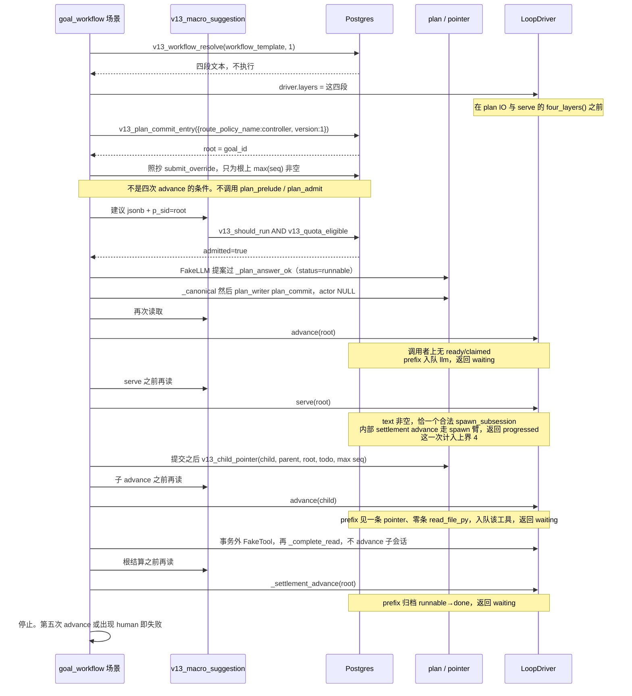
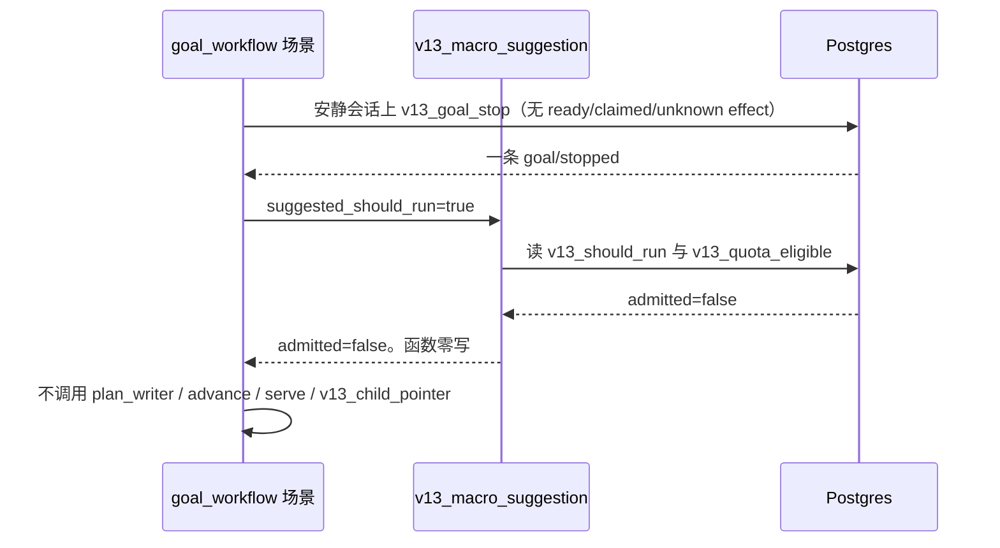
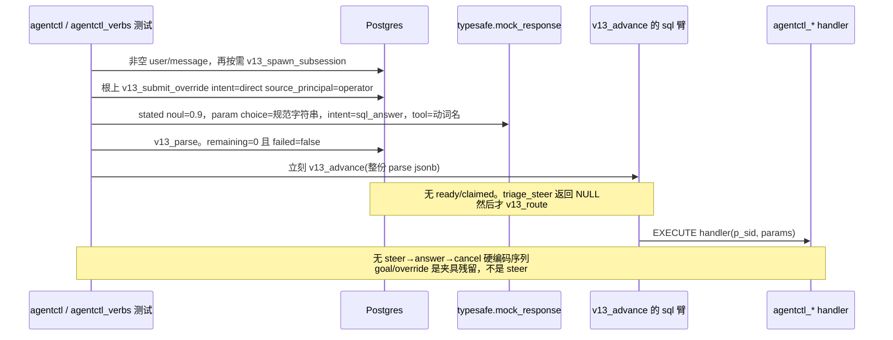

# v13 长期目标下调用工作流解决任务

| 项 | 值 |
|---|---|
| 作者 | （待填） |
| 日期 | 2026-10-06 |
| 状态 | Draft |
| 继续开发的版本 | v13（不是 v14 / v15） |
| 活体装载 | `v13/load.py` 的 `STAGE_THROUGH` 停在 `fair_claim: 39`（`v13/load.py:98`） |
| 下一 stage 号 | 40，然后 41，然后 42。禁止 `40a` / `40b` 这种键 |
| 权威顺序 | `docs/plans/v13-long-loop-plan-2026-09-28.md` §2 的用户决定 > 该文件 T0–T7 > `docs/reviews/v13-agentctl-da-rulings-2026-10-03.md` > Phase A–D 合同 > 设计稿倾向。调查建议低于裁决 |

**2026-10-08 计划约束（仅适用于本计划）：** 本次用户约束高于 D-A.2 关于 file sink 的实现形状。v13 始终以数据库作为信息载体；数据库之外的中间文件不得承载 v13 控制状态或 projection state。该条只表示本计划不采用 D-A.2 的 file sink，不否认或改写 2026-10-03 的历史裁决；`docs/reviews/v13-agentctl-da-rulings-2026-10-03.md` 不修改、不回写，也不声称它从未包含 file sink。本计划继续禁止第二状态源、二次结算、外部 projection 对 PG 的写回与 LoopX 写路径；这不构成 stage 45 的历史水位查询合同或 gate 承诺。stage 45 明确不交付，现有一参 fold 不因此变成水位 fold。

**2026-10-08 D-3 死锁修订（Ruling A）：** 第 2 项的完成条件不再包含「引用 `steer/injected.payload.text` 的既有消费者」。正文消费保持未关闭，不是第 3 项的前置。stage 42 只等生产者提交 `v13: add agentctl steer answer cancel` 已在 `main`，且该树上 `test_agentctl_verbs.py` 与 `test_plan_arm.py` 都退出 0。不发明消费者。不改写已提交的 D-3、R11、R3b、F2。不写「取代 R11」。不把该提交标成「D-3 已闭合」或「S2 全链 gate 已满足 D-3」。

本文是实施计划。它不改运行时代码。实现者按文末 PR Plan 一次里程碑一次提交。

## Overview

v13 已经有三层名字，缺的是一条能变绿的调用链：在一个长期目标下面，宏观门先放行，中观把一条已有工作流展开成有序步骤，微观用唯一推进函数把一个 effect 走完。三层保持三层。不建第四层，不把三层收成一个新运行时。

第一份能变绿的验收是单 goal、Fake、有界轮数、无真实 provider。人不在场时，已有的 human 挂起只是停住。宏观建议可以来自夹具 jsonb；接纳与否由 Postgres 重跑现有 `v13_should_run` 与 `v13_quota_eligible`。中观是「政策行 + 已有 plan/todo + 已有 effect + 已有 `workflow/pointer`」加上四个控制动词的登记。微观推进者只有现有 `LoopDriver` 的一个实例。`GoalSupervisor.tick` 在这条场景里不运行。

stage 45 保持编号 45，但本计划明确不交付任何 projection 实现：不创建 `v13_workflow_project`，不创建 `v13/workflow_project/` 的 SQL、测试、setup 或 README 里程碑，不追加 `SQL_LOAD_ORDER`，不设置 projection gate，也不提供 stage 45 的 Python gate 命令。`events` 加上现有的一参 `v13_plan_todo_fold(uuid)` 仍是唯一载体；stage 42 已经通过该 fold 到达 `done`，stage 45 没有产品调用方。2026-10-08 的数据库-only 约束继续有效；D-A.2 的 file sink 不采用，但不否认或改写 2026-10-03 的历史裁决。

## Background & Motivation

路线图 `docs/plans/v13-layered-control-roadmap-2026-09-26.md` 已把 L0 / L1 / L2 固定。长期循环计划 §2 已决定：PG 是唯一控制语义 owner；外部 IO 不进事务；不建第二状态源，不建工作流引擎。UA 计划 §8 的声称句仍然有效，并且把「人可以离开生产终端」留在禁止清单里。

三层与仓库里的对应物：

| 层 | 时间尺度 | 性质 | 仓库里已经有的，本计划接着用 |
|---|---|---|---|
| LoopX = 宏观 | 天–周 | 性质级。建议可来自外部；执行授权必须由 Postgres 重跑 | 活体 `should_run` version 3（`v13/govern/v13_govern.sql:348-359`）。`human_pending` 的 effect `block` 写在该 INSERT 的 JSON `:352`；`:407-409` 是解释器，只在 effect 已经是 `block` 时返回这个 id。`v13_should_run`（`v13/should_run/v13_should_run.sql:195`，返回 `v13_should_run_gate IS NULL`）；session 局部 `v13_quota_eligible`（`v13/quota_window/v13_quota_window.sql:53`） |
| RepoPrompt-CE = 中观 | 时–日 | 动词级。观察、注入、应答、取消，加上一条工作流如何展开 | `workflow_template` version 1 / chain `first_real_chain`；`v13_workflow_resolve`（`v13/workflow_bind/v13_workflow_bind.sql:29`）只返回四段文本；`v13_child_pointer`（同文件 `:128`）是 `workflow/pointer` 的唯一写者；`RealChain`（`v13/real_chain/chain.py`）已把一条 advancement 任务走完 |
| agent-loop = 微观 | 秒–分 | 唯一推进函数。一个 effect 的路由、执行、结算 | 活体 `v13_advance` 是 `v13/plan_arm/v13_plan_arm.sql` 的替换体。`LoopDriver.advance` / `serve` / `_settlement_advance`（`v13/loop_driver/driver.py`） |

缺口是调用方向与第一份 Fake 剧本还没有 stage 号、没有 gate、没有闭集载荷。`v13/goal_supervisor/accept_unattended.py` 只证明 UA §8 那句窄声称。它不是三层已经跑通。纯 progress 夹具的第二轮停在 `human_pending`（reason `low_intent_confidence`，status `ready`），原因写在 UA 计划 §9.1–§9.2：`_snap_with` 只放 `{"sid": sid}`，`v13_route` 在 intent 为空时返回 human。那份说明里的「stage 38 活体 advance 在 `v13/control/v13_control.sql`」是当时的停点记录。今日装载后的 `v13_advance` 体在 `v13_plan_arm.sql`。空信封与 `v13_route` 的行为相同。不回写 UA 历史。

参照树只读，不移植。下列事实来自 `docs/investigations/v13-s1-s2-e-i-four-step-survey-2026-10-06.md` 已核对的引用，本计划保持：

- LoopX 无 `agentctl`。配额在文件锁（`loopx/control_plane/quota/accounting_admission.py`）。`build_quota_should_run`（`loopx/control_plane/quota/should_run.py` 约 `:264`）是建议。`build_scheduler_hint` 与 `decide_loop_disposition` 是纯函数。wake 执行是 opt-in `execute_codex_cli_local_scheduler_tick_result`。`outcome_floor` 在 `loopx/execution_profile.py`，不是 PG 约束。默认 authority provider 是 file。`postgresql_authority_store.ts` 五张表不含 quota / wake / outcome_floor。没有 PG 事件到 LoopX 文件的投影。
- CE 无 Postgres 控制面，无 `source_principal` 字段。调用者身份来自服务端路由。`claimedProcessID` 不授予权威。agent-run 的 `op=poll` 调用 `executeWait(args:forcePoll: true)`（`repoprompt-ce/Sources/RepoPrompt/Infrastructure/MCP/Agent/AgentRunMCPToolService.swift:425-426`）。`AgentSessionLinkMCPToolService` 另有 `executePoll(args:)`，调用在 `.../AgentSessionLinkMCPToolService.swift:124`，定义在 `:366`。`executeSteer` / `executeRespond` 改的是进程内 AgentMode 会话。`request_attention` 的 accepted 不是已唤醒。文件 `OracleExportFileWriter.swift` 声明的类型是 `GeneratedOracleExportFileWriter`。read_file 投影是单向物化，不读 Postgres。这些树不移植。

## Goals & Non-Goals

### Goals

1. 从 stage 39 起，用接续整数 40、41、42 把第一份 Fake 场景做成退出码 0。
2. 场景声称句的窄度与 UA §8 对齐（见「第一份绿场景」）。
3. S1 只登记 `agentctl_observe`。S2 在另一次提交里同时登记 `agentctl_steer`、`agentctl_answer`、`agentctl_cancel`。
4. 写明这条场景如何用现有 prefix / spawn / pointer / archive 避开 `low_intent_confidence`，且不改 `v13_advance` 与 `_snap_with`。
5. 把 steer 载荷、观察返回、宏观建议、审计三联收成闭集，实现者不再发明。

### Non-Goals

- 不建第二运行时、工作流引擎、第二状态源、`v13_agent_run`。不启用 LoopX authority store。不与 `postgresql_v0` 同库共存。
- 不把「人可以离开生产终端 / 真实 provider / 多日 soak」写成已经成立。真实 provider 是另一次授权。
- 不改 stage 1–16。不就地编辑 `fb295ac`（`fb295ac6c7459bb98dac57e37883af549d2d8a4c`）保护集里的 SQL。`v13/loop_driver/driver.py` 在 R1 哨兵之外必须字节等于 `fb295ac`。`v13/goal_supervisor/driver.py` 除已记录的三份例外必须字节等于 `78e77c7`（`78e77c710bf06a0a1c771b822a3837c5db4c66d0`）。`v13/fair_claim/v13_fair_claim.sql` 与 `v13/fair_driver/driver.py` 字节钉住。本计划的跑通不修改这些文件。
- 不改 `SUPERVISOR_MAX_TICKS`（`v13/goal_supervisor/driver.py:13`，值 2）。不改 `accept_unattended.py` 来加长 UA。
- 不新增 `effects.kind`（活体闭集 `judge|tool|llm|context_refresh|human`，`v13/schema/v13_core.sql:99-100`）。不新增 route 动作。不新增事件种类。不新增工作流表。不新增 session 列。
- 不把 `v13_child_pointer` 放进 STABLE 的 `agentctl_observe`。`loop_driver` 的 `ALLOWED_CONTROL_SQL`（`driver.py:31-49`）不含 `v13_workflow_resolve` 与 `v13_child_pointer`，本计划不把它们加进那份名单。
- 不调用 `v13_wake_is_satisfied_v1`。不调用 `v13_claim`（`v13/fanout/v13_fanout.sql:266`，不取 13002）与 `v13_claim_fair`（函数自 `v13/fair_claim/v13_fair_claim.sql:421`，`pg_advisory_xact_lock(13002, 1)` 在 `:477`）。
- 不把 I1、I2、I3、I4、D-9 写成第一份验收的前提。不把 D-9 叫成 I1–I4。不选 judge 档，不写换档边界表。
- 不把 S3（从 `LoopDriver` 抽出 claim/IO/complete）放上必经路径。
- E1 / E2 排在 stage 42 绿之后；E3 保留 stage 45 编号，但明确不交付、不排施工。worktree 绑定握手与 merge 人工门不排成 S2 之后的默认施工。
- 本计划不采用 file sink，v13 控制/投影状态不得通过数据库外中间文件传递。stage 43、44、45 不读写控制文件、projection file、receipt file 或外部恢复日志；不新增替代文件缓存、文件事件日志或文件水位记录。stage 42 已冻结的 `read_file_py` 任务读取不属于该禁令，仍经 `v13_complete` 回到既有 `effects/events`。
- stage 45 虽保持编号，但明确不交付：不创建 `v13_workflow_project`、不创建 `v13/workflow_project/` SQL/test/setup/README 里程碑，不添加 `SQL_LOAD_ORDER` 项，不添加 projection gate 或 Python gate 命令。`events` 与现有一参 `v13_plan_todo_fold(uuid)` 仍是唯一载体；若未来确有历史水位读取需求，只能届时重开更窄的两参 overload 讨论，不属于本次交付。
- stage 45 不启用 LoopX authority store，不调用 LoopX todo/quota/settlement/writeback 路径，不增加第二运行时。
- 仓库中的 SQL、Python、README、测试 fixture 仍可作为源文件；它们不是运行时的 v13 中间信息载体。

## Proposed Design

三层结构、唯一推进者和 stage 编号均不变。stage 45 保持编号 45 作为显式非交付边界：不增加 SQL 函数、目录、测试、setup、README、装载项、projection gate 或产品调用方。`events` 与现有一参 `v13_plan_todo_fold(uuid)` 继续承担数据库内唯一载体；stage 42 已通过该 fold 到达 `done`。

### 能力状态与交付边界

以下是**计划承诺的交付与明确非交付边界**，不是已经通过 gate 的实现。状态用语固定为「PG 子集 / 夹具限定 / 静态映射 / 明确不交付 / 延期 / 禁止」，不改变本文的权威顺序与既有裁决。

| stage | 状态 | 本计划交付 | 不可据此声称 |
|---|---|---|---|
| 40 `agentctl` | PG 子集 | 授权范围内的只读状态、可选 scheduler hint、已有 pointer | CE 进程会话 wait/poll 或 wake 已实现 |
| 41 `agentctl_verbs` | PG 子集 | 三个 PG 写包装、目录准入、冻结 `controller/1`，mock → parse → advance 路由证明。正文消费保持未关闭，不是本 stage 的完成条件，也不是 stage 42 的前置 | CE 进程内 `executeSteer` / `executeRespond` 已实现，或仅凭注入事件就证明正文被消费 |
| 42 `goal_workflow` | PG 子集 | 现有微观路径上的单 goal、Fake、四次 advance 有界集成；PG 独立重跑 should-run/quota | 调用了 LoopX `build_quota_should_run`，或完整 quota / outcome_floor / spend / settlement / writeback 生效 |
| 43 `external_exec` | 夹具限定 | 测试夹具绑定 `p_sid` 下的入口、允许动词与载荷分类，执行借用 41 的路径 | 真实注册身份、可信 bind、task lease 或外部可写授权已实现 |
| 44 `ce_map` | 静态映射 | 40/41 的 PG 表面与 CE 原语对照，函数签名/列存在性 gate | CE 会话运行时、进程恢复或 42 启动能力已实现 |
| 45 `workflow_project` | 明确不交付 | 保留编号 45；不创建 `v13_workflow_project`、不创建 `v13/workflow_project/` SQL/test/setup/README，不追加 `SQL_LOAD_ORDER`，不设置 projection gate 或 Python gate 命令。`events` 与现有一参 `v13_plan_todo_fold(uuid)` 是唯一载体；stage 42 已经通过该 fold 到达 `done`，stage 45 没有产品调用方 | 不得声称函数、历史水位 projection、第二载体、LoopX 消费或任何 stage 45 实现已经存在；D-A.2 的 file sink 不采用，但不否认 2026-10-03 历史裁决 |

| 参考能力 | 状态 | 范围与守卫 |
|---|---|---|
| quota（session 局部准入） | PG 子集 | 42 只重跑现有 `v13_quota_eligible`；不靠 `turn/material_spent` 消耗配额 |
| LoopX quota / 根树配额完整语义 | 延期 | session 局部门不等于 LoopX quota 状态；I1 未决，不由外部文件补权威 |
| `outcome_floor` | 延期 | 没有内化为 PG 约束，不算 42 交付 |
| LoopX spend / settlement / writeback | 禁止 | 不调用 LoopX todo / quota / settlement 写路径，不二次结算；45 也不写回 |
| registered-agent identity / trusted bind | 延期 | 43 只有夹具限定的 `p_sid` 绑定；不实现 `quota_registered_agents`，真实未支持身份 fail-closed |
| task lease | 延期 | 既有 effect lease 列不等于 LoopX task lease，不授外部执行身份 |
| wake / auto-wake / `request_attention` 唤醒链 | 延期 | 未实现；accepted 不等于 woken，scheduler hint 不替代唤醒，42 不调用 wake |
| oracle lanes | 延期 | 未实现独立 lane 承载，一次 FakeLLM 调用不算实现 |
| worktree 握手 / merge 人工门 | 延期 | 未实现或验证，包括 routed merge 对 `confirm_preview` 的拒绝；不算 44 映射交付 |
| `claimedProcessID` 授权 | 禁止 | 不授予权威，不作为 43 的可信身份绑定 |
| LoopX 五表 PostgreSQL authority store | 禁止 | 明确禁用；不是等待 43 或 45 启用，不与 `postgresql_v0` 同库共存 |

40–42 交付有界 PG 子集；43 是夹具入口分类；44 是静态映射；45 只保留编号且明确不交付。它们不代表完整 LoopX/CE 承载。

### 三层调用方向

方向固定为：宏观门先于中观展开，中观步骤再进入微观 advance。微观循环不读 LoopX 文件，不调用 LoopX 的 todo / quota / settlement 写路径。

同一部署只有一个推进者。第一份绿场景的推进者是**一个** `LoopDriver` 实例。`GoalSupervisor.tick` 不构造、不调用。不调用 `run_turn`、`decide`、`decide_exit`。场景不是 `RealChain._run`（`v13/real_chain/chain.py:110-152`）的整段复制。四次 `v13_advance` 要打中的返回，在 `v13_triage_steer` 之前就结束，所以下面三步不是这四次返回的条件：`plan_prelude`（`:116`）、`plan_admit`（`:121`）、`submit_override`（`:120`）。

照抄的是这些助手的合同，不是 `_run` 的全序列：

| 照抄 | 位置 | 场景用它做什么 |
|---|---|---|
| `_plan_answer_ok` | `chain.py:32-50` | 计划提案恰一条 todo：`task_class=advancement_task`，`status=runnable`，`verb=add_new`，`due` 为 null，`text` 长度 1..1024 |
| `_canonical` | `:182-207` | 把提案收成 `plan_commit` 的 canonical，`based_on_seq` 等于根上 `max(seq)` |
| `_spawn_answer_ok` | `:53-74` | llm 结果：`text` 去空白后非空，恰一个 `tool_calls` 元素，键集为 spawn 那一组，`name=spawn_subsession`，`args` 恰为 `{task}` |
| `_pointer` | `:242-257` | `v13_child_pointer(child, parent, v13_plan_map_root(child), advancement todo_id, 根上 max(seq))` |
| `_read_once` | `:259-283` | 事务外跑 FakeTool。先 `_assert_idle`（`:323-326`）。excerpt 非空且长度 ≤ 1024 |
| `_complete_read` | `:285-310` | 对那一个 effect `UPDATE ... RETURNING attempt_no, fence`，再五参 `v13_complete`，然后**不再** advance 子会话 |

这里的“中间文件”仅指数据库之外承载 v13 控制事实、projection state、watermark 或 receipt 的文件。stage 42 的 `read_file_py` 不属于该定义：它读取任务 subject 的 workspace 文件，不是控制面状态源，且在事务外执行；结果继续通过既有 `v13_complete` 进入 `effects/events`。不得把它改造成新的 file store，也不得为了数据库承载约束删除这条路径。stage 43、44、45 均不采用 file sink，不读写控制文件、projection file 或 sidecar receipt file。

`serve` 不能用来完成子会话上的 `read_file_py`。`LoopDriver.serve`（`driver.py:315-385`）在五参 `v13_complete` 之后总会调用 `_settlement_advance`（`:376`）。子会话上再 advance 一次，prefix 的子臂要求 `read_file_py` 计数为 0（`v13_plan_arm.sql:152`），读已经存在时这条臂返回 NULL，同一次 advance 会继续走到 `v13_route`。读文件的领用与完成照 `_complete_read`：FakeTool 在 claim 事务之外；领用与五参完成在随后的事务里。这仍是同一个 `LoopDriver` 的连接与它已经使用的五参 `v13_complete`（`driver.py:180-185`），不是第二个推进者，也不是 `agentctl_answer`。`agentctl_answer` 只接受 `kind=human`。

`LoopDriver.four_layers`（`driver.py:402-405`）读 `self.layers[name]`。`serve` 在任何 SQL 之前调用它（`:326`）。计划提案那次调用也走 `four_layers`（`chain.py:173`）。`layers` 为空时这里是 `KeyError`，llm 不会被完成。场景在 `v13_workflow_resolve` 返回之后、第一次 `four_layers()` 之前，把四段文本放进 `driver.layers`。不拼接成一行。

水位是另一件事，不属于那四次返回。`v13_plan_writer` 的 `plan_commit` 读根上 `max(seq)`，空则 `RAISE 'v13: plan writer: waterline'`（`v13/plan_contract/v13_plan_contract.sql:866-869` 与 `:422-424`）。`v13_open_session` 不写事件。`v13_plan_prelude`（同文件 `:102-121`）是 `STABLE`，只回 `{version}`，不建立水位。`RealChain` 在 `plan_writer` 之前调用的 `submit_override`（`chain.py:120`，载荷在 `driver.py:166-171`）会写下 `goal/override`，这是它的水位。场景可以照抄这一次调用，只为让 `_canonical` 看得到 seq。这次调用不决定四次 advance 在 `v13_route` 之前返回。`v13_plan_admit` 不被 `v13_plan_writer` 读取；actor 为 NULL 时写者查的是 `v13_control_operator`（`v13_plan_contract.sql:811-814`）。测试超级用户下不调用 `plan_admit`。省掉水位就停，不准改 `v13_plan_writer`。



宏观拒绝时不调用 `plan_writer` / `advance` / `serve` / `v13_child_pointer`。函数本身零写。夹具可以先有开会话那一行，以及 `v13_goal_stop` 写下的一条 `goal/stopped`：



控制动词不走 llm 的 `tool_calls`。`v13_llm_tool_calls`（`v13/spawn/v13_spawn.sql:94-133`）对 `name <> spawn_subsession` 或 `args` 键集不是 `{task}` 的元素 `RAISE 'v13: tool_calls shape'`。S1/S2 的执行记录是 `typesafe.mock_response` → `v13_parse` → `v13_advance`，动词名来自夹具的 `answers.tool`。这不是第二个部署级推进者：场景不调用 `v13_parse`，也不执行三个写函数。`LoopDriver._snap_with`（`driver.py:288-299`）继续只放 `{"sid": sid}`，本计划不改它。场景路径到不了 `v13_triage_steer`，所以场景不靠下面这套夹具。

**S1/S2 打到 sql 臂的夹具顺序。** 活体 `v13_advance` 在 `v13_route`（`v13_plan_arm.sql:742`）之前有几处返回。夹具必须让这些返回都不发生，然后 `v13_triage_steer`（`:738-741`）返回 NULL。不要改 `v13_triage.sql`、`v13_envelope.sql`、`v13_advance`。不要往政策里加 `triage` 带当作通路。

1. 开会话。stage 40 用测试库里的冻结政策 `agentctl_observe_probe` version 1。stage 41 用已冻结的 `controller` version 1。两条都是复制 `default` version 2 的带，再加该次工具 param/stated 的 pass 带 `[0.60, Infinity)`。不加 `triage` 带。`v13_open_session` 不写 `parent_session_id`。
2. 在**调用者**上追加一条非空 `user/message`（`payload.text` 经 `btrim` 后非空）。`v13_triage_project` 在没有这种行时把 `fold_empty` 设为 true（`v13/triage/v13_triage.sql:161-164`）。`v13_triage_decide` 先看它并返回 `reject`（`:93-95`），早于 override，也早于 `ancestor_depth`。`reject` 会 closeout 或停住子会话，不会走到 `v13_route`。
3. 动词需要目标时，直接调用 `v13_spawn_subsession`。它写 `child-created` 与子会话上的 `spawn/task`，不在调用者上 `INSERT` effects（函数体 `:318-464`）。advance 入口若看见调用者上 `status IN ('ready','claimed')` 的 effect，在 spawn 臂和 prefix 之前返回 `waiting`（`v13_plan_arm.sql:404-466`）。调用者上不得留下这种行。
4. **根**调用者在 `v13_parse` 之前调用 `v13_submit_override`。载荷键恰为 `{intent, reason, schema_version, source_principal}`，`schema_version` 为数字 1，`intent` 为 `direct`，`reason` 为 `""`，`source_principal` 为 `operator`。闭集只接受 `user` 或 `operator`（`v13_triage.sql:264-268`）。活体驱动器用的就是 `operator`（`driver.py:166-171`），不是 `controller`。这一步写一条 `goal/override`。它若排在 parse 之后，snap 的 `max_event_seq` 过期，`v13_advance` 在 `:359-368` 返回 `stale`。
5. 准备 mock，覆盖 `mock_from_needed` 对未指定 noul 填的 `0.1`（`v13/loop/test_loop.py:126`）。`stated` 的模板种类是 `noul`（`v13/envelope/v13_envelope.sql:958`）。`v_routes` 的带是半开区间 `[lo, hi)`（`v13/schema/v13_core.sql:564-577`）。新的 pass 带是 `[0.60, Infinity)`，`0.1` 落在外面。每一条 `stated::<tool>::<key>` 都写成 `{"type":"noul","noul":0.9}`。`v13_resolve_tool_params`（`v13/loop/advance.sql:177-179`）只在这条 stated 命中 `pass` 时，才把对应 `param::` 的 `choice` 字符串抄进参数。每一条 `param::<tool>::<key>` 的 choice 是 handler 接受的规范字符串：`ids` / `target` / `effect_id` 为 uuid 文本，`text` / `response` 为该动词的闭集字符串，`hint` 为 `true` 或 `false`。`intent` 的 choice 为 `sql_answer`，`tool` 的 choice 为该动词名，`gate_action` 的 noul 为 `0.9`（与 `answers_sql` 相同，`test_loop.py:138-147`）。`v13_route` 对 `sql_answer` 与 `tool_action` 走同一分支（`advance.sql:138-140`）；夹具用 `sql_answer`。
6. `v13_parse`。断言返回的 `remaining = 0` 且 `failed = false`。`remaining` 是缺口数组的长度（`v13/resolve/v13_resolve.sql:542`，经 `:691` 放进返回值）。`remaining > 0` 时 advance 在 `:724-736` 入队 judge 并返回 `waiting`，早于 triage。parse 写的是 `decisions`，不改 `sessions.next_seq`，所以 parse 返回的整份 jsonb 可以立刻交给 `v13_advance`。
7. 立刻 `v13_advance(sid, parse 返回的整份 jsonb)`。根上 `user_intent_override=direct` 时 `v13_triage_decide` 返回 `direct`（`:100-101`），`v13_triage_steer` 在 `:430-431` 返回 NULL，然后才是 `v13_route` 与 sql 臂（`:771-813`）。

根上省掉 override 时，decide 落到 `none`（`:117`）。父会话为空，steer 在 `:454-456` 入队 human，reason 为 `triage_fail_closed`；政策没有 triage 带时 `:488` 再入队一次。handler 不被调用。

另一条能让 steer 返回 NULL 的现有路径是非根调用者：同样先有非空 `user/message`，且 `parent_session_id` 非空。`ancestor_depth >= 1` 时 decide 返回 `direct`（`:112-116`），steer 在 `:430` 返回 NULL；即便 decide 为 `none`，`:446-447` 也返回 NULL。这条不需要 override。S2 不选它。写动词的 actor 必须是目标的父会话，路由发生在根上，根才是产品夹具。非根只说明「仓库里还有一条不用 override 的通路」，避免实现者以为只能改 triage。

`v13_validate_answer` 在 criteria 为 NULL 时，`NOT (NULL ? choice)` 不进入拒绝（`v13_resolve.sql:590-594`）。「parse 拒绝自由文本就停」不是这条路的失败。失败是：noul `0.1` 没命中带，handler 收到 `{}`；或根上没有 override，先入队 `triage_fail_closed`。停在这个顺序上。不准改信封或 advance 去修绿。

这条夹具会留下一条 `goal/override`。它不是 `steer/injected`，不放进动词的 `write_targets`。差集窗口从动词调用前一刻开始。



### 第一份绿场景

**声称句（stage 42 的 README、矩阵行、测试 docstring 使用这一句，不准加宽）：**

> 单 goal、测试超级用户、Fake 夹具、场景自有 advance 上界 4（常数只活在 `v13/goal_workflow/test_goal_workflow.py`）、无真实 provider、唯一推进者是一个 `LoopDriver`：宏观门放行后，`workflow_template` version 1 / `first_real_chain` 展开成一条 advancement todo、一个子会话、一次 `read_file_py`、根上归档为 done，根与子都没有 human effect。已有 human pending 时场景停在非终态、不 skip、不 complete、不 cancel。这不是人可以离开生产终端。

**任务读取边界。** stage 42 的 workspace `read_file_py` 继续按 `_read_once` / `_complete_read` 工作：这是任务 subject 读取，不是 v13 控制状态或 projection state；结果仍通过五参 `v13_complete` 进入既有 `effects/events`。stage 45 不读取、复制、归档或重建该 workspace 文件，也不改变 stage 42 的读取行为；上面的声称句保持原样。

**根 goal。** `goal_id = session_id`（长期循环计划 T1 已有）。根由 `LoopDriver.plan_commit_entry` 打开，spec 闭集为：

```json
{"route_policy_name": "controller", "version": 1}
```

`v13_plan_commit_entry`（`v13/plan_contract/v13_plan_contract.sql:155-177`）只检查 version 然后调用 `v13_open_session`（`v13/spawn/v13_spawn.sql:285-315`）。`v13_open_session` 不检查政策行是否存在；sessions 只能引用已经 frozen 的 route policy（`v13/schema/v13_core.sql:453` 的触发器说明）。`controller` version 1 在 stage 41 冻结。stage 42 不再插入这份政策。根没有父会话，所以根上的 `plan_commit` 仍走 `plan_writer` 的 actor NULL，与 `RealChain` 相同（`driver.py:214-218`）。这是 T1.4 的现有入口。控制动词的 actor 永远是调用者的 `p_sid`，不是 NULL。

**模板。** 已有 `workflow_template` version 1，chain `first_real_chain`（`v13_workflow_bind.sql:10-27`）。`v13_workflow_resolve` 返回 assertion / assembly / judgment / workflow 四段非空文本。场景把这四段放进 `driver.layers`，不拼接成一行，不把它们当程序执行。`LoopDriver.four_layers`（`driver.py:402-405`）已经规定不合并、不回写。FakeLLM 收到的是这四段的有序对，断言里禁止出现四段拼接后的单个字符串。`layers` 未赋值就调用 `serve` 或计划 IO，会在 SQL 之前 `KeyError`。

**四个微观步骤。** 常量 `GOAL_WORKFLOW_MAX_ADVANCE = 4` 只出现在新测试里。进入第 1 步之前，todo 折叠的 `status` 已经是 `runnable`（`_plan_answer_ok`）。调用者上没有 `ready` / `claimed` effect，否则 `:404-466` 在 spawn 臂和 prefix 之前返回 `waiting`。四次 `v13_advance` 是：

| # | 谁调用 | 微观 effect | 为什么不到 `low_intent_confidence` |
|---|---|---|---|
| 1 | `advance(root)` | prefix 入队一个 `llm`。`v13_selected_todo` 只在 `advancement_task` 或 `continuous_monitor`、`status=runnable`、且没有排除绑定的时候把 `dispatch` 设为 `provider`（`:86-94`）。`request.route.reason = selected_todo` | `v13_plan_advance_prefix`（`:120` 起，调用点 `:510-512`）返回 `waiting`，advance 在 `:511-512` 返回，不到 `:742` 的 `v13_route` |
| 2 | `serve(root)` 内部的 `_settlement_advance` | FakeLLM 答案同时满足 `_spawn_answer_ok`：`text` 去空白后非空，恰一个合法 `tool_calls` 元素。`serve` 自己在 `text` 空白时返回 `blocked`，不调用 complete（`driver.py:327-334`）。五参 `v13_complete` 在 `text` 缺失或空白时把 llm 标成 `failed`，不写 `tool/call`（`v13/acl/v13_acl.sql:402-407`）；`tool/call` 只在结果仍为 `succeeded` 时写入（`:424-427`）。`v13_llm_tool_calls` 还要求 `args` / `id` / `name`，`name=spawn_subsession`，`args` 恰为 `{task}` | 有 `tool/call` 时，spawn 臂在 prefix 之前返回 `progressed`。收集在 `:468-481`（聚合到 `:479`，`:480-481` 是 `PERFORM`）。长度检查与 `v13_should_run` 在 `:482-486`。`RETURN 'progressed'` 在 `:508`。没有 `tool/call` 时这条臂不进入，同一次 advance 会继续往路由走 |
| 3 | `advance(child)` | prefix 的子会话臂：恰一条 `workflow/pointer`、零条 `read_file_py`，入队 `read_file_py`。指针参数与 `_pointer` 相同：child、parent、`v13_plan_map_root`、advancement todo、根上 `max(seq)` | 同函数 `:144-158` 返回 `waiting`。读文件若已经存在，`v_read_n = 0` 不成立，这条臂返回 NULL |
| 4 | `_settlement_advance(root)` | prefix 见子会话上已成功的 `read_file_py` 与仍为 `runnable` 的 advancement todo，写 `todo_delta` `runnable→done` | `:183-205` 返回 `waiting` |

第 4 次之后停止。再 advance 一次根，prefix 在没有选中 todo 时返回 NULL（`:292-294`）。`v13_route` 只返回 jsonb：intent 缺失或未命中 pass 时是 `action=human`、`reason=low_intent_confidence`（`v13/loop/advance.sql:134-135`）。入队发生在 `v13_advance` 的后段，不在 `v13_route` 里面。`_snap_with` 的信封仍是 `{"sid": sid}`。场景不提供更富的信封。这四次返回用的是 prefix 与 spawn 臂，不是更富的信封。第五次 advance，或成功剧本里出现 human 行，gate 失败。不准改 `v13_advance` 或 `_snap_with` 去修绿。

pending 的 todo 让 `v13_selected_todo` 给不出 `dispatch=provider`。prefix 在 `:292-294` 返回 NULL，**同一次** `v13_advance` 继续往 `v13_route` 走。所以第 1 步之前的 status 必须已经是 `runnable`，不能只写「一条 advancement_task」。

`v13_plan_advance_prefix` 在 `NOT plan_gate OR NOT should_run` 时返回 NULL（`:289-290`），然后活体 advance 会继续走到路由。因此宏观门是调用方在 `plan_writer` / `advance` / `serve` / `v13_child_pointer` **之前**的只读，不是 `v13_advance` 体内的新臂。`LoopDriver.serve` 的领用 `UPDATE` 本身不读 `should_run`（`driver.py:360-366`）。场景在 `serve` 之前再读一次。单推进者 Fake 下，读与写之间的并发窗口接受为已知限制，不写成「fence 已经咨询 should_run」。

**成功时库里必须能看见的行。**

- 根上恰一条 `plan/committed`，一条 `task_class=advancement_task` 的 todo，折叠后 `status=done`。
- 恰一个子会话，`parent_session_id` 是根。
- 子会话上恰一条 `workflow/pointer`，写者路径只经过 `v13_child_pointer`。
- 子会话上恰一条 `status=succeeded` 的 `read_file_py`，`result.excerpt` 为非空字符串且长度 ≤ 1024（`chain.py` 的 `EXCERPT_CAP`）。
- 根上 llm effect 成功，其 `tool/call` 的 `name` 为 `spawn_subsession`。
- 根与子的 effects 里 `kind=human` 的行数为 0。`type=steer/injected` 的行数为 0。水位那一次 `submit_override` 留下的 `goal/override` 允许存在，它不是 human，也不是 steer。
- 第 4 次 advance 的返回词是 `waiting`。根与子的 `sessions.status` 都不属于 `completed|failed|cancelled`。
- `turn/material_spent` 在这条 read 路径上不作为成功条件。quota 计数只数这种事件（`v13_quota_window.sql:94-99`），本场景不靠它消耗配额。

**宏观门失败。** 函数 `v13_macro_suggestion(p_sid uuid, p_suggestion jsonb) RETURNS jsonb`，`STABLE`，`search_path=pg_catalog, public`。ACL 与 `v13_agentctl_observe` 相同：`REVOKE PUBLIC`，`GRANT EXECUTE` 给 `v13_route`，不走 `v13_tool_session_stats` 那种保留 PUBLIC 的先例（`v13_core.sql:911-935`）。它不是 `tools` 行，不进信封目录。建议闭集：

```json
{
  "schema_version": 1,
  "kind": "macro_suggestion",
  "subject_session_id": "<与 p_sid 相同的 uuid 文本>",
  "suggested_should_run": true,
  "note": "可选，字符串，btrim 后长度 ≤ 256"
}
```

未知键、类型不对、`kind` 不是 `macro_suggestion`、`subject_session_id` 不是 `p_sid`：返回 `{ok:false, reason:"shape", admitted:false}`，不 RAISE，零写。会话不存在：返回 `{ok:false, reason:"missing", admitted:false}`，并且不调用 `v13_should_run` 与 `v13_quota_eligible`。前者经 `v13_should_run_gate` 在会话缺失时 RAISE（`v13_govern.sql:373-376`），后者同样 RAISE `v13: unknown session`（`v13/quota_window/v13_quota_window.sql:66-68`）。`suggested_should_run` 必须是 jsonb boolean，读入后丢弃，不参与与运算。

接纳位是另一次读取：`admitted = v13_should_run(p_sid) AND v13_quota_eligible(p_sid)`。返回还带两个布尔以及 `v13_should_run_gate` 的文本（NULL 表示没有 block）。`goal_stopped` 或配额不合格时，即使建议写着 `true`，`admitted=false`。场景就此返回，不调用 `plan_writer`。函数本身零写。`scene_macro_reject_zero_write` 的夹具是安静会话：没有 `ready` / `claimed` / `unknown` effect，否则 `v13_goal_stop` 在 `:271-276` RAISE `v13: goal busy`。停掉之后，`v13_goal_stop` 先追加一条 `goal/stopped`（`:280-286`），然后 `should_run` 才为 false。允许留下的是开会话那一行加上这一条 `goal/stopped`。`plan/committed`、`todo/delta`、effects 的新增计数为 0。

**human pending。** 独立夹具，不是成功剧本的另一种结局。

- `scene_solved_no_human`：成功剧本若出现 human effect 或 `low_intent_confidence`，gate 失败。这是失败，不是安静的成功。
- `scene_human_pending_holds`：先用现有 `v13_enqueue_effect` 在根上放一条 `kind=human`、`status=ready` 的 effect。`should_run` version 3 的 JSON 把 `human_pending` 的 effect 写成 `block`（`v13_govern.sql:352`，INSERT 在 `:348-359`）。解释器在 `:407-409`：该 effect 已经是 `block` 且 `v13_pending_human` 为真时返回这个 id。所以宏观门 `admitted=false`。场景停止。不 skip、不 complete、不 cancel。human 行保持 `ready`。会话保持非终态。这条停是合同上的成功停止，**不是**「任务被解决」。无人值守 skip 仍未授权（T2）。

**断言名（stage 42）。**

| 断言 | 证明 |
|---|---|
| `scene_solved_no_human` | 上表成功行；human 与 `steer/injected` 均为 0；advance 次数 = 4 |
| `scene_archive_waiting` | 第 4 次返回 `waiting`；todo 折叠为 `done`；两边 status 非终态 |
| `scene_layers_unjoined` | `v13_workflow_resolve` 四键都在；FakeLLM 参数里没有拼接串 |
| `scene_macro_reject_zero_write` | 安静会话上 `v13_goal_stop` 之后建议为 true、`admitted=false`；允许已有一条 `goal/stopped`；零新增 `plan/committed`、`todo/delta`、effects |
| `scene_suggestion_shape_zero_write` | 未知键返回 `reason=shape`；相关表计数不变 |
| `scene_human_pending_holds` | human 仍 `ready`；无 `cancel/requested`、无 `human/responded`；无 skip/complete/cancel 调用 |
| `scene_no_wake_no_claim` | 场景源码与新 SQL 不含 `v13_wake_is_satisfied_v1`、`v13_claim(`、`v13_claim_fair`、`13002`、`13003` |
| `actl_driver_untouched` | `driver.py` 哨兵外字节仍等于 `fb295ac` |
| `actl_scene_no_decide_exit` | 新场景 AST 不调用 `decide` 与 `decide_exit`，不调用三个 `agentctl_` 写函数 |
| `scene_advance_cap` | 常数为 4，且第 5 次调用会先断言失败而不是真的再 advance |

`actl_driver_demoted` **延期**。它要求 `driver.py` 不再走 `decide_exit`，而该文件哨兵外字节不能改，所以这条断言不能靠改 `driver.py` 变成真。S3 不在本跑通的必经路径上，不改写成「抽出 claim/IO/complete」。替代断言就是上表两行，它们不碰 `driver.py`。

### 如何避开 `low_intent_confidence`

空信封会 human，这是活体事实，不是待修缺陷：

- `LoopDriver._snap_with` 把 `envelope` 设为 `{"sid": sid}`（`driver.py:295`）。
- `v13_env_answer` 取不到 intent 时，`v13_route` 返回 `action=human`、`reason=low_intent_confidence`（`v13/loop/advance.sql:134-135`）。
- 手造一个没有 `decisions` 行的信封过不了 `v13_env_hit`。本计划不为场景去插判断行，也不改 `_snap_with`。

场景避开它的办法是：每一次 `v13_advance` 都打在会于 `v13_route` 之前返回的臂上（上表四行）。子会话的读完成后不 advance。根归档后不 advance。找不到这条现有路径时本应停笔；路径已在 `RealChain` 与 `v13_plan_advance_prefix` 里，所以不发明新路由词。

**风险（高）。** prefix 返回 NULL 之后，同一次 advance 仍会走到 `v13_route`。`v13_route` 返回 human jsonb，入队在 advance 的后段。调用方若忽视宏观门，或 todo 不是 `runnable`，或 llm 的 `text` 为空因而没有 `tool/call`，停止条件不成立。缓解：门为 false 时不调用 advance；第 1 步前 status 已是 `runnable`；spawn 答案过 `_spawn_answer_ok`；成功断言把 human 行数钉死为 0。出现 human 就停，不准改 `v13_advance` 或 `_snap_with` 去「修绿」。

### S1：stage 40，只观察

新目录 `v13/agentctl/`。`r1_load_append_ok`（`v13/plan_arm/test_plan_arm.py:327`）把 stage 键与 SQL 目录名绑在一起，且键不可重复。因此 stage 40 的目录名就是 `agentctl`，只有一个 SQL 文件。

`r1_phase_d_prefix_allowance`（同文件 `:409`）今日拒绝三前缀之外的路径，新鲜文件只允许 `v13/goal_supervisor/accept_unattended.py`。`v13/agentctl/` 会被拒绝。`git grep` 在 `fb295ac` 上找不到 `r1_phase_d_prefix_allowance` 与 `r1_load_append_ok`，所以改这两个函数的函数体，不触碰 `r0_source_scope`（`:635`）对 `fb295ac` 旧函数的字节相等。若实现者发现该断言报 `changed existing test`，停，不准放宽 AST 例外。

放行与 stage 40 的新文件同一提交。闭集是路径列表，不是「任意 `v13/` 目录」，也不是提前放进 stage 41/42 的路径。合成拒绝仍要留着：三前缀外的陌生目录、闭集之外的 `v13/agentctl/extra.py`、非规范 load 行（含 `"agentctl": 40a,` 这种加号行）、跳号。

**工具。** 恰一行：

| 列 | 值 |
|---|---|
| name | `agentctl_observe` |
| kind | `sql` |
| handler | `v13_agentctl_observe(uuid, jsonb) → jsonb` |
| 易变性 | `STABLE` |
| 事件 | 函数自身零事件。不调用 `v13_append_event`，不调用 `v13_child_pointer` |
| 属主 / ACL | 固定 `search_path=pg_catalog, public`。`REVOKE PUBLIC`。`GRANT EXECUTE` 给 `v13_route`。不授予 `v13_recall`。不走 `v13_tool_session_stats` 那种保留 PUBLIC 的先例（`v13_core.sql:911-935`） |
| `v13_named_sql_writer` | 不挂。目录守卫在 `v_vol NOT IN ('i','s')` 时才走 VOLATILE 豁免（`v13/catalog/v13_catalog.sql:36-55`）。STABLE 落在这个 `IF` 之后，再接受 jsonb 返回值与 `v13_route` 的 `EXECUTE`（`:56-64`）。观察函数不需要那份豁免 |

`spawn_subsession.enabled` 保持 true（插入点 `v13_spawn.sql:1757-1760`）。gate 读这行。D-2 只在台账与 parity 勘误里记录「parity §6 R6（`docs/reviews/v13-control-plane-parity-rpce-loopx-2026-09-26.md:236`）写 enabled=false，活体为 true」。不把「维持 true」写成功能交付。不改写台账里已经关闭的 F22 历史行（那是 catalog VOLATILE/parse，不是这句目录缝）。R11 不写进这次勘误。stage 41 也不写「取代 R11」；若追加勘误，只说明该生产者现在会存 text，消费仍未交付，原句不改。

**请求闭集。** 键只能是 `{ids, hint}` 的子集。`ids` 必填，两种形态都接受，因为 `v13_resolve_tool_params`（`advance.sql:169-182`）只会把 choice 收成 JSON 字符串：

- jsonb 数组，元素都是规范 uuid 文本（直接调用、场景之间的只读）；
- 单个规范 uuid 字符串（sql 臂能送到的形态）。

`hint` 缺省、jsonb `false`、或字符串 `false`：不取 hint。jsonb `true` 或字符串 `true`：只对 `v13_observe` 实际返回的会话调用 `v13_scheduler_hint`。其他类型或其他键：不 RAISE，返回

```json
{"schema_version":1,"ok":false,"reason":"shape","rows":[],"hints":[],"pointers":[]}
```

不调用 hint，也不调用 `v13_observe`。这样 sql 臂不会把形状失败收成 failed effect。重复 id、空数组、非 uuid：同样走形状失败。

**成功返回。**

```json
{
  "schema_version": 1,
  "ok": true,
  "rows": [],
  "hints": [],
  "pointers": []
}
```

`rows` 来自 `v13_observe(p_sid, ids)`（`v13/observe/v13_observe.sql:43-128`）的列：ordinal、session_id、parent、status、spawn_kind、is_terminal、turn_no、last_event_seq、last_event_type、pending_human、cancel_pending。任一 id 未授权（含自己：`v13_control_authorized` 在 `p_actor = p_target` 时为 false，`v13/acl/v13_acl.sql:109-110`）时，`v13_observe` 整次零行（`:86-88`）。包装函数把它收成 `ok=true` 且三个数组都空，并且不调用 hint。直接调用 `v13_scheduler_hint` 对未知会话仍 RAISE `v13: unknown session`（`v13_govern.sql:526-528`）；gate 要保留这次 RAISE。hint 文本只可能是 `run_now|wait|dont_notify`（同函数 `:517-575`）。

`pointers` 是对已返回 id 的 `SELECT`：`events.type = workflow/pointer`，字段 `session_id, event_id, seq, payload`。这是读，不是调用写者。

stage 40 不创建 `controller` 政策。路由证明在测试库里自插一份冻结政策，名字固定为 `agentctl_observe_probe` version 1：复制 `default` version 2 的带，再加 `param::agentctl_observe::ids`、`stated::agentctl_observe::ids`、以及 hint 的 param/stated 四条 pass 带 `[0.60, Infinity)`。不加 `triage` 带。测完随库 DROP。产品行留到 stage 41，避免在四个工具的 param 尚未齐时提前冻结 `controller`。

`param_spec` 只有 `ids` 与 `hint`。每个值有非空 `question` 与 `stated`。不写有限 `options`。criteria 为 NULL 时 `v13_validate_answer` 不拒绝 choice（`v13_resolve.sql:590-594`）。`actl_observe_routed` 使用上文「S1/S2 打到 sql 臂的夹具顺序」：调用者是根，非空 `user/message`，直接 `v13_spawn_subsession` 建一个子会话且调用者上无 ready/claimed，`v13_submit_override` 在 parse 之前，`stated` 的 noul 为 `0.9`，`param::agentctl_observe::ids` 的 choice 是该子会话的 uuid 文本，`hint` 的 choice 是 `true` 或 `false`，`remaining=0`，`failed=false`，然后立刻 advance。期望残留一条 `goal/override`。handler 收到的 `ids` 是那个 uuid 文本，不是 `{}`。根上省掉 override 时期望 human reason 为 `triage_fail_closed`，且 handler 不被调用。不准改 `v13/envelope/v13_envelope.sql`、parse 或 triage。

### S2：stage 41，三员同笔

目录必须是 `v13/agentctl_verbs/`。`r1_load_append_ok` 不允许第二份 SQL 再使用键 `agentctl`。闭集在这一提交追加本 stage 的精确路径，仍不包含 stage 42。

三个函数同一次提交：`SECURITY DEFINER`，`search_path=pg_catalog, public`，`ALTER FUNCTION ... OWNER TO v13_spawn_owner`，`REVOKE PUBLIC`，`GRANT EXECUTE` 给 `v13_route`。`v13_spawn_owner` 已是 `NOLOGIN NOSUPERUSER`（`v13_spawn.sql:279-280`）。属主不得因此变成 operator：`v13_control_operator`（`acl.sql:74-87`）在 `current_user` 为该属主时必须为 false。gate 断言 `rolsuper` 为 false，且 `pg_has_role('v13_spawn_owner', 'v13_route', 'USAGE')` 为 false。三个包装传给 complete/cancel 的 actor 是 `p_sid`，不是 NULL。源码扫描禁止出现一参 `v13_cancel` 与五参 `v13_complete`（它们把 actor 填 NULL 再落到 operator，`acl.sql:236-242` 与 `:459-470`）。

调用者升权的口子是 DEFINER 里的 `v13_control_operator()`。属主没有 `v13_route` 的成员资格，这条为 false。不要 `GRANT v13_route TO v13_spawn_owner`。

**政策。** 不改 `default` version 2（`v13/real_chain/v13_real_chain.sql:79-160` 的种子与漂移检查保持原样）。

1. `v13_route_policies` 插入 `controller` version 1，状态 draft。复制 `default` version 2 的全部 threshold 行。再为四个工具各自的 param/stated 信号插入 pass 带 `[0.60, Infinity)`。信号名是 `param::<tool>::<key>` 与 `stated::<tool>::<key>`，key 只来自下面的 param_spec。然后 `state=frozen`。冻结之后不能再追带。
2. `v13_policies` 插入 `controller_surface` version 1，`active=true`。value 只有：

```json
{
  "schema_version": 1,
  "route_policy_name": "controller",
  "route_policy_version": 1,
  "tools": ["agentctl_observe", "agentctl_steer", "agentctl_answer", "agentctl_cancel"]
}
```

没有 goal 文本，没有授权结论，没有结算事实。不新增 session 列。信封 SQL 冻结，工具目录对每个 enabled 的 sql/tool 可见（`v13_envelope.sql:422-446`）。非 controller 会话仍可能在目录里看见这四个名字。三个写函数在写之前读调用者会话的 `route_policy_name/version`，不是 `controller` / 1 就 RAISE，零持久写。这是 fail-close，不是去改信封。

**steer。** 包装 `v13_append_event(target, event_id, 'steer/injected', payload)`。`v13_append_event`（`v13_core.sql:62-93`）返回 bigint seq，并 `UPDATE sessions` 的 `next_seq`。`event_id` 由函数 `gen_random_uuid()` 生成后传入。`trg_events_goal` 只在 `user/message` 时插 goal 行，`steer/injected` 不产生 goal。

工具参数闭集恰为 `{target, text}`。出现 `source_principal` 或任何其他键：在 `v13_append_event` 之前 RAISE，零 `steer/injected`，目标 `next_seq` 不变。`text` 为字符串，`btrim` 后长度 1..1024。`target` 为规范 uuid 文本。`v13_control_authorized(p_sid, target)` 为 false（自己、兄弟、祖先、不存在的目标）同样 RAISE、零写。调用者政策不是 `controller`/1：同样零写。

写入的载荷只能由函数内部构造，键恰为：

```json
{"schema_version": 1, "text": "<btrim 后的 text>", "source_principal": "controller"}
```

`schema_version` 是 SQL 写的数字 1。`source_principal` 永远是字面量 `controller`，从当前 `p_sid` 的政策身份派生，覆盖载荷里的自报。载荷里不放调用者 uuid。

`trg_v13_control_event_guard` 的 `WHEN` 列表不含 `steer/injected`（`v13/control/v13_control.sql:478-481`），所以上面这些键会插入。这是合同变化，不是新的事件种类。D-3 允许 `source_principal=controller`，并要求 gate 覆盖正文消费，且与 watermark 分开。覆盖不是「冻结树里已经有读者」。本生产者写入 `text`，这是相对 R3b 登记 `{schema_version:1}` 的草稿超集。parity §6 R11 原句不改。stage 41 台账不写「D-3 对本生产者取代 parity R11」。可以追加一条 R6 式勘误：该生产者在数字 `schema_version` 1 写入 `text` 与字面量 `source_principal`，所以 R11 的「正文未写」不再描述这个生产者；消费未交付；原句保留。不改写 F22。S1 的勘误仍只覆盖 R6。

返回 jsonb：`{schema_version:1, caller:<p_sid 文本>, target:<目标文本>, event_id:<传入 append 的 uuid>, seq:<append 返回的 bigint>}`。审计三联是 caller、target、event_id。不建表、不加列。sql 臂把这个返回值放进既有 `effects.result` 与 `tool/result`。事后从这两处现推。直接调用若丢弃返回值，事件行上没有调用者 uuid；gate 必须读返回值。不准为了补 uuid 而加列。

**S2 残项：steer 正文消费（D-3，未关闭）。** 2026-10-08 搜索 live tree 的 v13 SQL/Python 并复核候选路径，未找到把 `steer/injected.payload.text` 送入目标后续判断、工具参数、goal 或 effect 的既有消费者。`v13/control/test_control.py:516-524` 仅追加无 text 的事件并证明冻结 request 不变、旧信封 stale、原 token 可完成；`v13/memory/v13_memory.sql:113-127` 的正文投影仅接受 `user/message|llm/message`；`v13/triage/v13_triage.sql:161-164` 检查的是 `user/message` 正文。这些都不是 steer 正文消费证据。`v13_session_log`、审计三联、watermark/stale、`actl_chain_full` 也不是。

该残项不挡住第 2 项判绿或提交，也不是第 3 项的前置。第 2 项的全绿是三个 DEFINER 动词、冻结 `controller` / 1、`controller_surface`、sql 臂夹具，以及 D-3 的身份、授权、零写、watermark。`actl_steer_body_consumed` 不得作为通过的断言存在。退出码 0 只表示生产者已交付、消费公开未闭合。不发明消费者，不改冻结运行时、第二运行时或新表。不得把这次提交标成「D-3 已闭合」或「S2 全链 gate 已满足 D-3」。这不等于 CE 进程内 steer。

**answer。** 参数闭集恰为 `{target, effect_id, response}`。`response` 为非空字符串，长度 ≤ 1024。无 `skip` 键。授权与 `controller` / 1 政策检查先于任何 `UPDATE`。然后：

1. effect 必须是 `kind=human`、`status=ready`、`session_id=target`，且 `request` 含 `interaction_ref`（六参 complete 的 human 通道在 `acl.sql:330-379`）。否则 RAISE，此时还没有任何 UPDATE。
2. 同函数内：

```sql
UPDATE effects
   SET status = 'claimed',
       attempt_no = attempt_no + 1,
       fence = fence + 1,
       lease_owner = 'agentctl_answer',
       lease_until = clock_timestamp() + interval '1 hour'
 WHERE effect_id = <目标>
   AND session_id = <target>
   AND status = 'ready'
   AND kind = 'human'
 RETURNING attempt_no, fence
```

零行则 RAISE，不调用 complete。这不是 `v13_claim`，也不取 13002，也不是 S3。S3 仍是「把 LoopDriver 的 claim/IO/complete 抽成驱动器侧三步」，本计划不做。
3. 把 `RETURNING` 的两个值传给六参 `v13_complete(p_sid, effect, attempt, fence, 'succeeded', result)`（`acl.sql:245`）。`result` 由 SQL 构造，键恰为 `schema_version`（数字 1）、`interaction_ref`（从 effect.request 复制，不从调用者参数复制）、`response`。不传 `skip`。
4. 返回词不是恰好 `accepted` 就 RAISE。`stale`（`:300-308`，行未被领成 claimed 或 attempt/fence 不符时不写）和 `replay`（`:303-305`）都不是零写成功：第 2 步的领用已经发生，忽略返回词会把领用留在已提交的函数结果里，sql 臂再把包装的 jsonb 收成一条成功的 tool effect。RAISE 让领用与 complete 留在同一个事务里。

六参 complete 在 actor 非空且 kind 不是 human 时，于那些写之前 RAISE（`:269-271`）。gate 扫描包装源码：传给六参的 status 位置只能是字面量 `succeeded`。因此 complete 体内的 `unknown` 臂（`:448-450`，会 `UPDATE sessions` 到 `blocked_unknown`）与 `worktree_release` 臂（`:451-455`）从本包装不可达。

非 human、已领走、终态、缺 `interaction_ref`、政策不符：在领用 UPDATE 之前 RAISE，零持久写。handler 在领用之后 RAISE 时：直接调用必须让异常冒出，领用不提交；经 sql 臂时，臂的 `EXCEPTION` 子事务（`v13_plan_arm.sql:786-798`）回滚这次领用，然后插入一条 failed tool effect、不写 `tool/result`（`:800-807`）。那条 failed effect 是活体 sql 臂，不是 `accepted` 的应答。`actl_approval_two_phase` 用一份错的 fence 证明：返回词不是 `accepted`，effect 在异常之后仍是 `ready`。

**cancel。** 参数闭集恰为 `{target}`。先 `v13_control_authorized`，再两参 `v13_cancel(p_sid, target)`（`acl.sql:121`）。不调用一参形式。授权失败在两参函数的持久写之前 RAISE（`:134-137`）。临时表 `v13_fanout_cancel_tree` 是已有的 `ON COMMIT DROP`（`:144-149`），不是新的持久目标，不进 `write_targets`。两参 `v13_cancel` 只把 `status='ready'` 的 effect 改成 `cancelled`（`:227-230`）。没有 ready 行时，成功调用仍然经 `v13_append_event` 插入 `cancel/requested` 并拨动 `sessions.next_seq`（`v13_core.sql:68-83`），不改 `sessions.status`。持久差是 `events` 与 `sessions`，没有 `effects`。终态会话上两参返回 `replay`（`:201-203`），发生在临时表填充之后、持久 UPDATE 之前。本包装不 closeout 会话，所以第二次调用不是这条 `replay`。

**write_targets。** 设计稿里手写的 `{events}` 不是事实：`v13_append_event` 已经写 `sessions`。gate 用执行差，不用那份手写集合。差是**直接调用**该 handler 的窗口，从调用前一刻到调用返回。窗口外的夹具序言（`user/message`、`goal/override`、`child-created`）不算。sql 臂自己插入的 tool effect 也不算进 handler 的集合。

1. 窗口内对 `events` 计数、对目标 `sessions.next_seq`、对 `effects` 的状态、对 `artifacts` 与 `latches` 计数做差。
2. 有插入或有目标列变化的持久表集合，必须等于 `v13_named_sql_writer` 里该 handler 的 `write_targets`。数组按字母序，以便与既有 spawn 臂的 jsonb 比较习惯一致。
3. 期望集合是**这一份成功夹具**的差，不是每条返回路径的并集：
   - steer：成功夹具差为 `["events","sessions"]`。`v13_append_event` 插入 `steer/injected` 并拨动 `next_seq`。
   - answer：成功夹具差为 `["effects","events","sessions"]`。领用 `UPDATE` 加上六参 complete 的 effect 更新、`effect_done` 与 `human/responded`（`acl.sql:441`）。返回词必须是 `accepted`。
   - cancel：成功夹具先在目标上放一条 `status=ready` 的 effect，差为 `["effects","events","sessions"]`。没有 ready 行的那次调用差只有 `events` 与 `sessions`，不得拿来当期望集合。差集里不出现 `v13_fanout_cancel_tree`。
4. `actl_cancel_sticky`：同一条仍非终态的会话上再调用一次。`v13_unconsumed_cancel` 为真时跳过第二次 `cancel/requested`（`acl.sql:223-225`）。计数保持 1。返回词不是 `replay`。
5. 拒绝路径：直接调用必须在异常处停住，且窗口内 `steer/injected` 计数与目标 `next_seq` 不变。经 sql 臂调用时，臂会捕获异常并插入一条 failed tool effect、不写 `tool/result`（`v13_plan_arm.sql:786-812`）。那条 failed effect 是活体 sql 臂，不是 `steer/injected`。断言把这两件事分开。

`v13_spawn_writer_ok`（`v13_spawn.sql:1657-1687`）把 `v13_named_sql_writer` 的返回值与 spawn 那份四表 jsonb **精确相等**才为 true。只改 `v13_named_sql_writer` 会让三个新 VOLATILE 工具在插入触发器（`:1631-1641`）和目录守卫上失败，或者反过来把 spawn 的集合改坏。stage 41 的新 SQL 里 `CREATE OR REPLACE` 这两个函数，不编辑 `v13/spawn/v13_spawn.sql`。替换后的 `v13_spawn_writer_ok`：

- 对 `v13_spawn_subsession` 保持今日全部检查，且 jsonb 仍是 `artifacts, events, latches, sessions`，`mutating=false`。
- 对三个新 handler 做同一套属主、DEFINER、search_path、REVOKE PUBLIC、VOLATILE、`(uuid,jsonb)→jsonb`、无 IO 记号检查，jsonb 分别等于上表。
- 其他名字返回 false。

`mutating:false` 沿用 spawn 臂已经在用的记号。它不是「函数不写表」。写了哪些表由 `write_targets` 与执行差证明。

加臂的 `CASE` 写在这份追加 SQL 的 `CREATE OR REPLACE` 里。文件顺序：先替换两个谓词，再 `CREATE` 三个函数并 `ALTER OWNER`，再 `INSERT` 三行 tools，再插入并冻结 route policy，再插入 `controller_surface`。

**Python。** stage 41 测试里的 Python 只做「S1/S2 打到 sql 臂的夹具顺序」里的执行记录。三份夹具各有一个动词名，调用者都是根（目标的父会话），都在 parse 之前做 `v13_submit_override`，`stated` 的 noul 都在 `[0.60, Infinity)`，`param` 的 choice 都是该 handler 接受的规范字符串。断言路由到的 tool 等于该夹具。测试文件里没有一份生产代码按 steer→answer→cancel 的顺序硬编码控制流。场景（stage 42）不走这套 parse。它的 FakeLLM 只发出过 `_plan_answer_ok` 的计划提案，以及一个过 `_spawn_answer_ok` 的 `spawn_subsession`。若夹具发出 `agentctl_*` 名字，场景 RAISE 并且不执行写函数。场景没有第三种 Python 写分发器。

**风险（中）。** 全局目录使非 controller 会话也能看见工具名。信封不能改。缓解是写函数 fail-close。观察函数不查 `controller` 政策：它只读，授权仍是 `v13_control_authorized`。stage 40 的探针政策不是产品行。

**风险（中）。** 根上的 parse→advance 若省掉非空 `user/message` 或 `intent=direct` 的 override，会在 sql 臂之前入队 `triage_fail_closed`。`stated` 若留着 `mock_from_needed` 的 noul `0.1`，handler 收到 `{}`。缓解是停在夹具顺序上，而不是改 envelope、advance 或 triage。直接调用仍然是 1024、零写、以及 answer 非 `accepted` 即 RAISE 的合同证明。

### 观测

没有新的 metrics 栈，没有新的日志管道。观测就是行、gate 断言、以及既有 hint 文本。

| 要看的 type 或行 | 在哪一步出现 |
|---|---|
| `plan/committed`、`todo/delta` | 中观展开与归档 |
| `tool/call`、`child-created` | spawn 臂 |
| `turn/route`，payload 里 `reason=spawn_fanout` 或 `action=sql` | spawn 臂；S1/S2 的 sql 臂另有一条 `turn/route` |
| `tool/result`、`llm/message`、`effect_done` | 结算 |
| `workflow/pointer` | `v13_child_pointer` |
| `steer/injected` | 只有 S2 的 steer 成功路径。成功剧本的计数是 0 |
| `human/responded` | 只有 `agentctl_answer` 成功。挂起夹具的计数是 0 |
| `cancel/requested` | 只有 `agentctl_cancel` 成功。挂起夹具的计数是 0 |
| effects.kind | 仍是 `judge\|tool\|llm\|context_refresh\|human`。成功剧本用到 `llm` 与 `tool` |
| `v13_scheduler_hint` | `run_now`、`wait`、`dont_notify`。未知会话 RAISE |

`turn/material_spent` 只在 harness 的 progress/finish 收据路径出现。本场景的 `read_file_py` 不把这种行当成功条件。

### 失败与人

见上节 `scene_human_pending_holds` 与 `scene_solved_no_human`。两句同时成立：挂起夹具的停止是合同成功；成功剧本里出现 human 是 gate 失败。场景不把 human effect 标成 skipped、succeeded 或 cancelled 来「清掉」它。

### 从 39 到变绿的顺序

能并进一次提交的才并。S1 与 S2 必须分成两次提交。设计稿 §7 的五条与 §8 的 OQ-J1–J4，以及 `docs/investigations/v13-phase-d-reopen-reference-survey-2026-10-02.md` §8.2 / §8.4 里已被 2026-10-03 裁决覆盖的句子，在 stage 40 那一次提交里标注「已裁」，不单独做空提交。标注是追加说明，不删原文，不改写 UA 历史。

**依赖合同。** 后一 stage 的编号更大，不意味着前一 stage 是它的功能输入。「能力消费」只列功能依赖；「连续装载前置」列 `files_through` 的累计装载；「施工排序」只列里程碑先后。42 从 41 只消费冻结的 `controller/1`，不调用四个 agentctl 动词，40 不在其执行路径上；但顺序装载到 42 仍不能跳过 40。44 的编号装载前置包含 43，却不消费 43 的分类政策。45 不消费 43 的政策或 44 的映射；45 也不提供任何实现或 gate。

| stage / 目录 | 消费什么能力 | 连续装载前置 | 施工排序 | 这一次变绿的是什么 |
|---|---|---|---|---|
| 40 `agentctl` / `v13/agentctl/` | 既有 `v13_observe`、授权谓词、scheduler hint 与 pointer 读 | 1–39（`fair_claim: 39`） | 第 1 项 | 观察工具 + 冻结放行闭集 + 已裁标注 + D-2 勘误 |
| 41 `agentctl_verbs` / `v13/agentctl_verbs/` | 40 的观察工具面，加既有 append / ACL / complete / cancel | 1–40 | 第 2 项，在 40 之后 | 三个写动词 + `controller` / `controller_surface` + sql 臂夹具 + D-3 的身份、授权、零写、watermark。正文消费未关闭，不是本项完成条件 |
| 42 `goal_workflow` / `v13/goal_workflow/` | 从 41 仅消费冻结 `controller/1`；其余为既有 workflow / plan / pointer / advance 路径 | 1–41，包含 40，不能跳过 | 第 3 项，在 41 生产者提交进入 `main` 且该树上两条 gate 退出 0 之后；不等正文消费闭合 | 第一份绿场景 |
| 43 `external_exec` / `v13/external_exec/` | 41 的工具名与 parse → advance 夹具路径；不消费 42 场景能力 | 1–42 | 第 4 项，在 42 全绿之后 | 夹具入口分类 |
| 44 `ce_map` / `v13/ce_map/` | 40/41 的 PG 表面及既有函数/列；不消费 43 分类政策 | 1–43，编号前置包含 43 | 第 5 项，在 43 之后且在第一份绿门之外 | 静态映射 |
| 45 `workflow_project` / `v13/workflow_project/` | 不消费任何能力，也不交付实现 | 不追加 SQL stage 装载；不创建该目录的 SQL/Python/setup/README 里程碑 | 第 6 项仅保留编号位置；它不构成 42 的前置、功能依赖或施工任务 | 明确非交付边界；无函数、无 projection gate、无 Python gate 命令。`events` 与现有一参 `v13_plan_todo_fold(uuid)` 仍是唯一载体，stage 42 已通过该 fold 到达 `done` |

每一阶段明确不改：`v13/loop/advance.sql`、`v13/plan_arm/v13_plan_arm.sql`、`v13/loop_driver/driver.py`、`v13/goal_supervisor/driver.py`、`v13/goal_supervisor/accept_unattended.py`、`v13/fair_claim/v13_fair_claim.sql`、`v13/fair_driver/driver.py`、`v13/spawn/v13_spawn.sql`、`v13/envelope/v13_envelope.sql`、`v13/acl/v13_acl.sql`、`v13/real_chain/v13_real_chain.sql`、stage 1–16 的文件。`v13/plan_arm/test_plan_arm.py` 只改两个 `fb295ac` 之后才出现的冻结谓词函数，以便放行新路径；`r1_driver_restore` 与 `r0_source_scope` 的旧函数体不动。

stage 39 装载时的锁类扫描（`v13_fair_claim.sql:61-74`）在更晚的函数诞生之前运行，而且禁止 `v13_advance` 的函数体里出现 `CREATE OR REPLACE FUNCTION public.v13_claim(`（`:58-59`）。新 SQL 仍不得包含 `13002`、`13003`、以及替换 `v13_claim` 的语句。有实现交付的 stage 40–44 的 gate 扫描自己的 `pg_get_functiondef`；stage 45 没有新函数或 gate。

### 跑通之后的里程碑

调查 §3 写过：E1–E3 当时解锁的是「计划成文」，不是建 stage。本文件就是那份计划。E1/E2 排在 stage 42 绿之后，不排进第一份验收，也不把 stage 42 说成外部承载已经跑通；E3 只保留 stage 45 编号作为明确非交付边界，不排成施工里程碑。能力状态以上文「能力状态与交付边界」两表为准：43 夹具限定、44 静态映射、45 明确不交付；延期与禁止项不因计划成文而变成已实现。43、44、45 都不得读写控制文件，不依赖外部文件恢复状态。

**E1，stage 43，目录 `v13/external_exec/`。** 薄入口是新的场景侧函数，不是第二份 `v13_advance`，也不改 `driver.py`。政策行 `external_executor` version 1 的 value 只有 `schema_version` 与动词名列表（四个 `agentctl_*`）。身份只在测试夹具把 `p_sid` 绑进调用时成立。载荷里的 `source_principal`、以及列表之外的动词：返回 `{ok:false, reason:"unsupported"}`，零写。这个函数做分类，不自己调用三个写函数，避免变成第三分发器。真正执行仍是 stage 41 的 parse → advance，夹具顺序与「S1/S2 打到 sql 臂」相同（非空 `user/message`、根上 `submit_override`、stated noul 落在 `[0.60, Infinity)`、`remaining=0`）。

现有 `v13_parse` 快照字段 `route_policy_name` / `route_policy_version` 只证明冻结的 **`controller` / 1 路由政策**。gate 断言这两个值；不得把 `external_executor` 填进这些字段，也不得据此声称 `external_executor` 是 route policy 或其身份合同已冻结。不改信封函数、不增身份字段。43 不实现 `quota_registered_agents` 注册身份、真实外部调用者的 trusted bind 或 LoopX task lease；夹具绑定不等于可信产品入口。未支持的外部身份入口保持 `{ok:false, reason:"unsupported"}`、fail-closed、零写，不得临时借用外部文件或 `claimedProcessID` 授权。43 不向 42、44、45 提供或授予该身份授权，亦不启用五表 PostgreSQL authority store。

**E2，stage 44，目录 `v13/ce_map/`。** 一个 STABLE 函数返回下面这张闭集，**只有静态映射**，不新增动词，不新增 `v13_ce_shutdown`。gate 按这一列查，不写「签名仍在」这种没有符号的句子。函数签名和 lease 列存在不证明 CE 会话运行时、task lease 或进程恢复；44 不提供 42 的启动能力，也不消费 43 的分类政策。

| CE 原语 | 映射格 | gate 怎么查 |
|---|---|---|
| observe / poll（两条 CE 调用链，见下文） | `v13_agentctl_observe(uuid,jsonb)`，仅 PG 状态观察，不是 CE 进程 wait/poll 实现 | `to_regprocedure('public.v13_agentctl_observe(uuid,jsonb)')` 非空；映射注明 PG 只读状态观察，返回 hint 不等于 wake |
| `startOrResume` | `v13_enqueue_effect(uuid, text, jsonb, text)`，外加 `effects.lease_owner` 与 `effects.lease_until` 两列还在；**不代表 stage 42 的 session 创建路径** `plan_commit_entry → v13_open_session → advance` | `to_regprocedure('public.v13_enqueue_effect(uuid,text,jsonb,text)')` 非空（`v13_core.sql:210`）。两列在 `v13_core.sql:111`。列不是函数签名，分开断言；不据此验证 42 的启动语义 |
| `sendUserMessage` | `v13_append_event(uuid, uuid, text, jsonb, uuid)` | `to_regprocedure('public.v13_append_event(uuid,uuid,text,jsonb,uuid)')` 非空（`v13_core.sql:62`） |
| `steerUserTurn` | `v13_agentctl_steer(uuid, jsonb)` | `to_regprocedure('public.v13_agentctl_steer(uuid,jsonb)')` 非空 |
| `interruptTurn` | 两参 `v13_cancel(uuid, uuid)` | `to_regprocedure('public.v13_cancel(uuid,uuid)')` 非空（`acl.sql:121`）。不映射一参形式 |
| `respondToPermissionRequest` | 六参 `v13_complete(uuid, uuid, integer, bigint, text, jsonb)` | `to_regprocedure('public.v13_complete(uuid,uuid,integer,bigint,text,jsonb)')` 非空（`acl.sql:245`）。包装仍是 `v13_agentctl_answer`，映射格写的是六参函数 |
| `shutdown` | 字面量 `unsupported` | 映射 jsonb 的这一格等于 `unsupported`。`pg_proc` 里 `proname = 'v13_ce_shutdown'` 的行数为 0（任何参数列表都不算）。不把 `v13_requeue_stale`（`v13/twophase/v13_twophase.sql:33`）或 `v13_renew_lease`（`:78`）写成新的 shutdown 函数 |

`sendUserMessage` 与 `steerUserTurn` 是两格，不是同一格的两个名字。observe/poll 的参考也必须分成两条调用链记录，不能合并成一种 CE poll：

- agent-run：`op=poll → executeWait(args:forcePoll: true)`（`repoprompt-ce/Sources/RepoPrompt/Infrastructure/MCP/Agent/AgentRunMCPToolService.swift:425-426`）。
- session-link：`executePoll(args:)`（`repoprompt-ce/Sources/RepoPrompt/Infrastructure/MCP/Agent/AgentSessionLinkMCPToolService.swift:124` 调用、`:366` 定义）。

**未承载的 CE 能力：** worktree 绑定/merge（含 routed `confirm_preview` 拒绝）、auto-wake、oracle lanes 均未实现/延期，不在静态映射中算作完成。`claimedProcessID` 机制未实现，不授予权威，也不提供可信身份绑定。`request_attention` 的唤醒链未实现：accepted 不是 woken，stage 40 返回的 scheduler hint 不替代它。一次 FakeLLM 调用不替代 oracle lanes；44 不运行这些 CE 调用链。

**E3，stage 45，明确不交付。** 保留编号 45，以免后文重编号，但不把它排成实现或提交里程碑。stage 45 没有产品调用方，旧 file sink 不采用，LoopX 消费也不在本计划内；不能为了让新增接口被自己的测试调用而交付无产品使用路径的 projection。

**唯一载体与既有路径。** `events` 加上现有一参 `v13_plan_todo_fold(uuid)` 仍是唯一载体，stage 42 已通过该 fold 到达 `done`，不需要 stage 45。该函数读取已有事件并返回 todo 行，没有 watermark 参数，不能声称它提供历史水位结果。用忽略水位的包装或另写一份 JSONB fold 都不是本次交付。stage 42 的声称句、`read_file_py`、事务外 `_read_once` 与 `_complete_read` 调用五参 `v13_complete` 的路径均保持不变。

**非交付清单。** 本计划不交付 `v13_workflow_project`，不创建 `v13/workflow_project/` 下的 SQL、测试、setup 或 README 里程碑；不在 `SQL_LOAD_ORDER` 或 stage 装载映射中追加 45，不扩放行闭集，不添加函数、表、列、receipt、watermark state、工具目录项、route action、policy 行或事件类型。没有 projection worker、第二运行时、外部控制状态或数据库外 projection。

**无 projection gate。** `projection_repeat_idempotent`、`projection_out_of_order`、`projection_no_regression`、`projection_no_second_settlement`、`projection_zero_pg_writeback` 全部不交付、不要求创建；没有 stage 45 的 Python gate 命令，也不为 stage 45 增加 `plan_arm` gate 步骤。`project_crash_replay`、`project_delete_rebuild`、`project_human_overwrite` 等文件专属 gate 亦不交付，不以数据库 gate、receipt、临时文件或外部 replay log 替代。

**裁决与数据库边界。** D-A.2 在 2026-10-03 曾确认“事务外、幂等、可重建、防倒退、文件编辑不回流”的文件形状；本计划不否认该历史裁决，不修改或回写裁决文件。2026-10-08 的数据库-only 约束继续有效，本计划仍不采用 D-A.2 的 file sink。不得通过文件缓存、sidecar receipt、文件事件日志、文件水位或外部恢复日志补出第二载体；不调用 LoopX todo/quota/settlement/writeback 写路径，不二次结算，五表 PostgreSQL authority store 继续禁用。

**仅允许未来重开讨论，不属于本次交付。** 若后来出现明确产品调用方及真实历史水位读取需求，届时才能重开更窄的 `v13_plan_todo_fold(uuid, bigint)` overload 讨论；本计划不新增该 overload、不改变现有一参函数、不指定它的实现里程碑或 gate。当前选择是明确不交付，而不是用两参 overload 替换被否决的 projection 合同。

I1–I4 与 D-9 不编号、不给 gate 命令，直到 Open Questions 里对应的点被拍板。

## API / Interface Changes

新增，全部在新 SQL 文件里：

```sql
-- stage 40
v13_agentctl_observe(p_sid uuid, p_spec jsonb) RETURNS jsonb  -- STABLE

-- stage 41
v13_agentctl_steer(p_sid uuid, p_spec jsonb) RETURNS jsonb    -- VOLATILE DEFINER
v13_agentctl_answer(p_sid uuid, p_spec jsonb) RETURNS jsonb   -- VOLATILE DEFINER
v13_agentctl_cancel(p_sid uuid, p_spec jsonb) RETURNS jsonb   -- VOLATILE DEFINER

-- stage 42
v13_macro_suggestion(p_sid uuid, p_suggestion jsonb) RETURNS jsonb  -- STABLE; REVOKE PUBLIC; GRANT v13_route
```

`CREATE OR REPLACE` 只发生在 stage 41 的新文件中，对象是 `v13_named_sql_writer(text)` 与 `v13_spawn_writer_ok(text)`。`v13/spawn/v13_spawn.sql` 的字节保持 `fb295ac`。

不改 `v13_advance(uuid, jsonb)`、`v13_route(uuid, jsonb)`、`v13_complete`、`v13_append_event`、`v13_claim(text, integer)`、`_snap_with` 或其他既有 stage 1–44 接口。

stage 45 明确不交付 `v13_workflow_project` 或任何新增 API，不新增 fold overload、receipt API、file path 参数、file writer API 或外部回放 API。没有产品调用方、迁移或新增调用点；`events` 与现有一参 `v13_plan_todo_fold(uuid)` 仍是唯一载体，stage 42 已经通过该 fold 到达 `done`。

## Data Model Changes

无新表、无新列、无新 `effects.kind`、无新事件 type。stage 45 明确不交付任何 runtime artifact，不新增函数、projection/receipt/watermark 表、session/状态/receipt/watermark 字段或中间记录，不新增迁移数据，不追加 `SQL_LOAD_ORDER` 或 stage 装载映射，不回写既有 events、plan/todo、effects 或 settlement。`events` 与现有一参 `v13_plan_todo_fold(uuid)` 仍是唯一载体；stage 42 已通过该 fold 到达 `done`，没有 stage 45 projection 数据或函数需要清理。

新增行（stage 45 不在此表增加数据库行）：

| 表 | 行 | 哪一次提交 |
|---|---|---|
| `tools` | `agentctl_observe` | 40 |
| `tools` | 三个写动词 | 41 |
| `v13_route_policies` + `thresholds` | `controller` version 1，冻结 | 41 |
| `v13_policies` | `controller_surface` version 1 | 41 |
| `v13_policies` | `external_executor` version 1 | 43，不在第一份绿门 |

`v13_policies` 的 value 在触发器下不可改（`v13_core.sql:711-725`）。写错了用下一 version，不 `UPDATE` value。route policy 冻结后再改带必须是新的 `(name, version)`。

有实现交付的 stage 40–44 的迁移是 `SQL_LOAD_ORDER` 尾部追加；各自测试库由 `setup_db.py` DROP/CREATE，并 `files_through` 装到自己的 stage。不 DROP 开发者已有的库。stage 45 明确不交付，没有装载项、setup、测试库或迁移步骤。

## Alternatives Considered

1. **场景里用 Python 直接调用 steer/answer/cancel。** 会变成第三条写通道。`v13_llm_tool_calls` 也运不了这些名字。D-7 要求动词来自模型输出，由 `v13_route` / `v13_advance` 消费。拒绝。S2 的唯一执行记录仍是 parse→advance，并且走「打到 sql 臂的夹具顺序」。场景自己不 parse。
2. **把判断信封塞进 `_snap_with`，或在 `v13_advance` 里加 agentctl 臂。** 驱动器与 advance 都冻结。prefix 在 `should_run` 为 false 时返回 NULL，并不会安全停住。拒绝。宏观门放在调用方。
3. **新工作流表、新事件种类、或新的 `effects.kind`。** 现有 `plan/committed`、`todo/delta`、effect、`workflow/pointer`、`steer/injected` 已经盖住展开与三个写动词。没有找到词表不够的证明。拒绝。默认仍不新增。
4. **用 `GoalSupervisor.tick` 当推进者。** tick 不 `serve` llm，也不调用 `plan_writer`。`driver.py` 字节被钉住。`SUPERVISOR_MAX_TICKS` 不能改。human pending 时 tick 直接 `waiting` 返回（`v13/goal_supervisor/driver.py:211-216`）。拒绝。
5. **第一份 fence 改走 `v13_claim` 或锁 13002。** 那是 I4，而且 fair 文件字节钉住。场景的 fence 是 `LoopDriver.serve` 与 `RealChain._complete_read` 已有的、按 effect_id 精确更新的 `fence+1`。拒绝。

## Security & Privacy Considerations

威胁模型是同一数据库里的会话互相驱动，不是操作系统用户。

- 授权谓词是现有 `v13_control_authorized`：目标的 `parent_session_id` 必须等于 actor。自己、缺失会话、非父会话都是 false，对外统一成 `v13: session not found`，避免用不同错误确认目标存在。
- `source_principal=controller` 不是 operator。DEFINER 属主是 `v13_spawn_owner`。gate 证明它不是 superuser，也不是 `v13_route` 的成员。
- 模型自报的 `source_principal` 不入库。写载荷里的该字段只来自 SQL 字面量。
- 三个写函数、观察函数、以及 `v13_macro_suggestion` 都 `REVOKE PUBLIC`，`GRANT EXECUTE` 给 `v13_route`。目录守卫要求 `v13_route` 能 `EXECUTE` sql 工具。`v13_recall` 不能。宏观函数不是 `tools` 行，ACL 仍与观察函数相同，不保留 PUBLIC。
- 宏观建议不能把 `suggested_should_run=true` 变成接纳。接纳位只来自 PG 谓词。会话不存在时两个谓词都不调用。
- 外部 IO 不进事务。gate 只用 FakeLLM / FakeTool 与 `typesafe.mock_response`。测试进程不打开网络套接字。新函数体不得含 `dblink`、`pg_net`、`lo_import`、`lo_export`、`pg_read_file`、`pg_write_file`、`COPY PROGRAM`，与 `v13_spawn_writer_ok` 已扫描的记号相同。
- 审计不新增持久身份列。三联从 `p_sid`、目标参数、以及函数生成并传入 `v13_append_event` 的 `event_id` 现推，经返回 jsonb 进入既有 `tool/result`。
- 夹具仍是测试超级用户。本计划不声称 EXECUTE 与 operator 已经分成产品角色。
- stage 43、44、45 不读写控制文件；43 只以 PG policy/SQL 返回值做入口分类，44 只做数据库内静态映射，45 明确不交付 runtime artifact，不增加文件系统权限、外部 IO、文件缓存或外部恢复日志。
- stage 45 不交付 `v13_workflow_project`，因此没有函数专属 ACL、DEFINER、search_path 或输入合同变更，也没有 Python gate 或文件 writer；既有数据库接口的权限与授权纪律保持不变，不扩展 operator 权限，不从文件、模型输出、`claimedProcessID` 或外部 receipt 推导控制事实，不启用 LoopX authority store 或写路径。
- 仓库 SQL loader、源代码、测试 fixture 和 README 是源文件输入，不是运行时中间控制文件；这不构成创建 stage 45 SQL、测试、setup 或 README 的理由。
- stage 42 的 `read_file_py` 仍是必须保留的 workspace subject read，继续事务外 `_read_once`、五参 `_complete_read` / `v13_complete` 回到 `effects/events`；它不成为控制权威或 stage 45 的文件载体。

## Observability

见上文「观测」。告警就是 gate 非 0。没有新的计数器、没有新的日志格式。实现者看失败断言的名字，再查上表里的 `events.type` 与 `effects.kind`。

stage 45 明确不交付 `v13_workflow_project`、结果行断言、projection gate 或任何新增观测工件，不产生观测事件或 PG writeback。观测继续使用既有 `events` 与一参 `v13_plan_todo_fold(uuid)`；stage 42 的 `done` 由该 fold 读取，不由 stage 45 projection 证明。不采用 sidecar receipt、投影文件或替代数据库外日志。

## Rollout Plan

本文件的写作任务不提交、不改仓库。下面是以后实现者的顺序。仓库根 `Agents.md` 写的是「测试全绿再 `git add`」。`r1_phase_d_prefix_allowance` 用 `git ls-files -- v13` 建跟踪集（`v13/plan_arm/test_plan_arm.py:499-500`），`r1_load_append_ok` 拒绝目录不在这个集合里的追加 stage（`:393-397`）。`git ls-files` 不列出未跟踪文件。新的 `v13/agentctl/`、`v13/agentctl_verbs/`、`v13/goal_workflow/` 在进入索引之前会让 `plan_arm` 变红。因此每个里程碑把「新 `v13/<stage>/` 路径先 `git add`」插在 `plan_arm` 之前。文档在 `git ls-files -- v13` 之外，仍放在两次 gate 都绿之后的收尾添加里。

以下施工、装载、gate、收尾与提交步骤仅适用于有实现交付的 stage 40–44；stage 45 只保留编号，不新增任何 runtime artifact，不适用这些步骤，也不单独提交。

每个实现里程碑：

1. 按路径 `git add` 这一次新增的 `v13/<stage>/` 文件。同时暂存已经跟踪的 `v13/load.py` 与 `v13/plan_arm/test_plan_arm.py`。禁止 `git add -A` 与 `git add .`。`test_plan_arm.py` 只改 `r1_phase_d_prefix_allowance` 与 `r1_load_append_ok` 两个函数体。这两个名字在 `fb295ac` 上不存在，所以改函数体不触发 `r0_source_scope` 的 `changed existing test`（`:691-715` 那一段检查的是 `fb295ac` 已有函数）。模块级编辑仍会触发。若该断言报 `changed existing test`，停，不准放宽 AST 例外。
2. 跑该 stage 的 gate，再跑 `UV_FROZEN=1 uv run python v13/plan_arm/test_plan_arm.py`。任一个非 0 就停。修完再暂存同一批路径。本任务本身不提交。
3. 两次都绿之后，更新该 stage 的 README、`docs/reviews/v13-control-plane-conformance-matrix-2026-09-26.md`、`docs/reviews/v13-control-plane-deviation-ledger-2026-09-26.md`。然后按路径 `git add` 这些文档。
4. `git commit` → `git push origin main`。禁止 `--no-verify`，禁止 force-push。hook 失败修根因。

`r1_load_append_ok` 单独仍拒绝三前缀之外的路径（`test_plan_arm.py:473-476`）。路径闭集与该 stage 的新文件同一次提交，不把放行留到下一笔。

特性开关：没有会话级模式列。stage 42 的场景脚本要么被它自己的测试调用，要么不被调用。stage 45 明确不交付函数、SQL loader 项、测试、setup、README 或 projection gate，不提供 Python gate 命令；不启动投影进程、后台 worker、外部 scheduler 或文件同步任务，不创建 projection file、receipt file 或外部 watermark。

回滚：追加 SQL 的回滚是下一次前向提交，用新的尾部文件 `CREATE OR REPLACE` 收紧行为，或插入下一版政策行。不编辑 stage 1–39 的历史文件，不改写 git 历史，不 `reset` 已推送的里程碑。冻结放行的路径闭集只随那次前向提交增删；删路径时要同时确认 `git ls-files` 里已经没有该文件，否则 `r1_phase_d_prefix_allowance` 会拒绝这次提交。已经冻结的 `controller` version 1 不能解冻；前向修正是 `controller` version 2，新会话改指 version 2，旧会话保持 version 1。

stage 45 没有任何新增 runtime artifact、函数定义或持久 projection state，因此没有 stage 45 loader、测试、gate、函数修正、文件清理或数据回滚步骤。已有 PG 控制事实与一参 fold 保持原样；“删除文件后重建”不适用于本计划的 rollout/rollback，不以新 stage 或外部回滚日志补出实现。

阶段：40 先绿，41 的生产者提交再进入 `main`（两条 gate 退出 0；正文消费仍可未关闭），然后才允许写 stage 42。42 之前的 README 不得出现那句声称。41 的「全绿」不含 D-3 正文消费闭合。

## Open Questions

只留还没有被 Phase 0 或 2026-10-03 裁决钉死的点。

1. **I1。** 根树配额若要做，新的 block id 叫不叫 `goal_quota`；满额是 `block` 还是 `shadow`。第一份跑通用 version 3 与 session 局部 `v13_quota_eligible`，不依赖这个答案。
2. **I2。** 只读咨询 lane 的闭集大小，以及 lane 是否消耗 `spawn_budget`。调查里的 1+4 不是已裁常数。
3. **I3。** 谁调用 `v13_wake_is_satisfied_v1`：监督 tick，还是独立消费者。第一份跑通不调用它。
4. **I4。** 要不要重开「禁止 `CREATE OR REPLACE` 活体 `v13_claim`」。不重开则帽只约束 `v13_claim_fair`。
5. **E2 的工作区握手。** worktree 绑定握手与 merge 人工门，裁决没有排期。它们不是 S2 或 stage 44 的默认工作。若要做，另一次拍板。

## Key Decisions

1. **第一份推进者是一个 `LoopDriver`，不是 `GoalSupervisor.tick`。** tick 不服务 llm，监督驱动字节钉住，`SUPERVISOR_MAX_TICKS` 不能加长，human 挂起时它只报告。场景不是 `RealChain._run` 的整段复制。照抄 `_plan_answer_ok`、`_canonical`、`_spawn_answer_ok`、`_pointer`、`_read_once`、`_complete_read`。`plan_prelude` 与 `plan_admit` 不是四次 advance 返回的条件。`submit_override` 只为 `plan_writer` 的水位（`plan_prelude` 不写事件），不决定那四次在 `v13_route` 之前返回。`driver.layers` 在任何 `four_layers()` 之前赋成 `v13_workflow_resolve` 的四段。todo 在第 1 步之前是 `runnable`。llm 的 `text` 非空，且恰有一个合法 `tool_calls`。读在 claim 事务之外。
2. **子会话的读不用 `serve`。** `serve` 会在完成后 advance。读已经存在时 prefix 子臂返回 NULL，同一次 advance 走到 `v13_route`。照 `_complete_read`：事务外 FakeTool，然后 `RETURNING` 的 attempt 与 fence 交给五参 `v13_complete`，不再 advance。这不是第二个推进者。
3. **避开 `low_intent_confidence` 的办法是打在 prefix 与 spawn 臂上，于 `v13_route` 之前返回。** `v13_route` 只返回 jsonb；入队在 `v13_advance` 后段。不修 `_snap_with`，不发明路由词。调用者上已有 ready/claimed、todo 不是 `runnable`、或没有 `tool/call` 时，同一次 advance 到不了这两条臂。归档后再 advance 一次是 gate 失败。
4. **宏观门在调用方，不在 `v13_advance` 新臂里。** prefix 对 `should_run=false` 返回 NULL，并不会停住后续路由。建议 jsonb 的布尔被丢弃。
5. **S1 与 S2 分成 stage 40 与 41。** load 谓词把 stage 键与目录名绑死，第二份 SQL 不能再叫 `agentctl`。所以写动词在 `v13/agentctl_verbs/`。禁止 `40a`/`40b`。
6. **控制动词经 `v13_parse` → sql 臂，不经 `tool_calls`。** `v13_llm_tool_calls` 只接受 `spawn_subsession`。场景 FakeLLM 只发这一种 tool_call，而且场景不调用 `v13_parse`。S1/S2 的根夹具在 parse 之前有非空 `user/message` 和 `v13_submit_override`（`intent=direct`，`source_principal=operator`），调用者上没有 ready/claimed，`remaining=0`，每条 `stated::agentctl_*::*` 的 noul 在 `[0.60, Infinity)`，每条 `param::` 的 choice 是 handler 接受的规范字符串。criteria 为 NULL 时 parse 不拒绝自由文本。停笔指向这个顺序，不指向改信封。非根且父会话非空是另一条能让 `v13_triage_steer` 返回 NULL 的路径；S2 用根。
7. **`controller` 是冻结的 route policy 加 `controller_surface` 行，不是 session 新列。** 信封不能改，因此写函数 fail-close。不改 `default` version 2。
8. **steer 载荷闭集为 `{schema_version:1, text, source_principal:"controller"}`，text 长度 1..1024。** 参数里若出现 `source_principal` 则零写。审计三联走返回值与既有 `tool/result`。
9. **`v13_spawn_writer_ok` 与 `v13_named_sql_writer` 在 stage 41 的新文件里一起替换。** 否则 VOLATILE 工具插不进目录，或 spawn 的四表集合被改坏。`write_targets` 是直接调用的执行差，窗口不含夹具序言。steer 成功是 events+sessions。answer 成功是 effects+events+sessions，且六参 complete 的返回词必须是 `accepted`，否则 RAISE，领用回滚。cancel 的期望集合钉在「目标上已有一条 ready effect」的那份夹具上，也是 effects+events+sessions。没有 ready 行时差里没有 effects，那份差不是期望集合。第二次 cancel 走 `v13_unconsumed_cancel`，计数保持 1，返回词不是 `replay`。临时表 `v13_fanout_cancel_tree` 不进集合。
10. **`actl_driver_demoted` 延期，S3 不做。** 替代是 `actl_driver_untouched` 与 `actl_scene_no_decide_exit`。不改 `driver.py`。
11. **human 挂起是合同上的成功停止，不是任务解决。** 成功剧本里出现 human 则失败。不 skip、不 complete、不 cancel。
12. **D-2 只做勘误。** `spawn_subsession.enabled` 保持 true。parity R6 那句标成过时。不改写历史 F22 行。R11 不放进这次勘误，也不在 stage 41 台账写「取代」。stage 41 最多追加一句：生产者会存 text，消费未交付，R11 原句不改。
13. **CE 映射在 42 之后；E3 保持 stage 45 编号，但明确不交付。** 调查当时说「先写计划」，不等于要求建设 stage。stage 45 没有产品调用方，不交付 `v13_workflow_project`、不创建 `v13/workflow_project/` SQL/test/setup/README，不追加 `SQL_LOAD_ORDER`、不增加 projection gate 或 Python gate 命令。`events` 加现有一参 `v13_plan_todo_fold(uuid)` 仍是唯一载体，stage 42 已经通过该 fold 到达 `done`。两参 fold overload 仅能在未来出现真实消费者及历史读取需求时重开讨论，不属于本次交付。2026-10-08 数据库-only 约束继续有效，D-A.2 的 file sink 仍不采用，不否认或改写 2026-10-03 裁决。不调用 LoopX 写路径，不启用独立 authority store；stage 42 声称句与 `read_file_py` 路径保留，不改造成 stage 45 文件载体。
14. **本计划不选 judge 档，不写 D-8 换档表。** D-9 仍等尚不存在的 D-6 闭集 `choice|score|noul`，并且不是 I1–I4。

## Risks

| 严重度 | 风险 | 缓解 |
|---|---|---|
| 高 | 归档后再 advance，或对子会话 `serve`。`v13_route` 返回 human jsonb，advance 随后入队 | 上界 4；成功断言 human 行数为 0；禁止改 advance 与 `_snap_with` |
| 高 | 调用方无视宏观门，或 todo 不是 `runnable`，或 llm `text` 为空。prefix 返回 NULL 或 spawn 臂看不到 `tool/call`，同一次 advance 仍会走到路由 | 门在调用之前；status 先是 `runnable`；答案过 `_spawn_answer_ok`；失败即红 |
| 中 | 替换 `v13_spawn_writer_ok` 时把 spawn 的四表集合改坏 | 同一函数里保留 spawn 分支；gate 断言 `v13_spawn_writer_ok('v13_spawn_subsession')` 仍为 true |
| 中 | 冻结放行写成「整个 `v13/`」或提前放进下一 stage 的路径 | 精确路径；合成拒绝；与该 stage 同一提交 |
| 中 | 根上 parse→advance 没有非空 `user/message` 或 `direct` override，先入队 `triage_fail_closed`；stated noul 停在 `0.1`，handler 收到 `{}` | 停在夹具顺序上；不加 triage 带；不改 envelope、advance、triage |
| 中 | sql 臂把 steer 的 RAISE 收成 failed effect，看起来像「拒绝路径写了行」 | 断言分开：零 `steer/injected`、目标 `next_seq` 不变；failed effect 只允许出现在经 advance 的那次 |
| 低 | 单推进者下 should_run 在读与写之间变化 | 接受。不声称 fence 读了 should_run。不引入 13002 |
| 低 | 非 controller 会话在目录里看见写工具 | 写函数核对 route policy，不符则零写 |

## References

- `docs/plans/v13-layered-control-roadmap-2026-09-26.md`
- `docs/plans/v13-long-loop-plan-2026-09-28.md` §2、T0–T7、§9
- `docs/plans/v13-unattended-continuation-authorization-plan-2026-10-01.md` §8、§9.1、§9.2
- `docs/reviews/v13-agentctl-da-rulings-2026-10-03.md`
- `docs/investigations/v13-s1-s2-e-i-four-step-survey-2026-10-06.md`
- `docs/designs/v13-agent-control-minimal-form-2026-10-02.md` §5 的 `40a`/`40b` 不被采用；§7 与 §8 在 stage 40 标注已裁
- `docs/investigations/v13-phase-d-reopen-reference-survey-2026-10-02.md` §8.2、§8.4
- `docs/analysis/agent-control-plane-codex-rpce-loopx-2026-09-21.md` §3–§4
- `docs/reviews/v13-control-plane-parity-rpce-loopx-2026-09-26.md` §6 R6（约第 236 行，S1 勘误）与 R11（约第 240 行；原句不改。stage 41 不写「被 D-3 取代」，只可追加「生产者现已存 text、消费未交付」）
- `docs/reviews/v13-control-plane-conformance-matrix-2026-09-26.md`
- `docs/reviews/v13-control-plane-deviation-ledger-2026-09-26.md`
- 活体：`v13/load.py`、`v13/loop/advance.sql`、`v13/plan_arm/v13_plan_arm.sql`、`v13/loop_driver/driver.py`、`v13/real_chain/chain.py`、`v13/workflow_bind/v13_workflow_bind.sql`、`v13/acl/v13_acl.sql`、`v13/observe/v13_observe.sql`、`v13/govern/v13_govern.sql`、`v13/spawn/v13_spawn.sql`、`v13/quota_window/v13_quota_window.sql`、`v13/fanout/v13_fanout.sql`、`v13/fair_claim/v13_fair_claim.sql`、`v13/catalog/v13_catalog.sql`
- LoopX / CE 路径见调查已核对清单。不移植。

## PR Plan

本仓库没有 PR 栈。第 1–5 项各是 `main` 上的一次实现里程碑提交，每项独立可审：测试退出码 0，冻结文件的字节差为空，load 只追加。第 6 项保留编号，但为 stage 45 的明确非交付边界，不是实现或提交里程碑；不新增 stage 45 装载项、测试或 gate。

### 1. `v13: add agentctl observe tool`

| 消费什么能力 | 连续装载前置 | 施工排序 |
|---|---|---|
| 既有 observe / 授权 / hint / pointer 读 | `STAGE_THROUGH` 已有 1–39（`fair_claim: 39`） | 第 1 项；无其他未合并项 |

- **文件：**
  - 新增 `v13/agentctl/v13_agentctl.sql`、`test_agentctl.py`、`setup_db.py`、`README.md`
  - `v13/load.py` 只追加 `agentctl` / 40
  - `v13/plan_arm/test_plan_arm.py` 只改 `r1_phase_d_prefix_allowance` 与 `r1_load_append_ok`：精确路径闭集加合成拒绝
  - 标注已裁：`docs/designs/v13-agent-control-minimal-form-2026-10-02.md` §7 与 §8；`docs/investigations/v13-phase-d-reopen-reference-survey-2026-10-02.md` §8.2 与 §8.4
  - D-2：parity 文件 R6 那句加勘误，不把原文涂改成从未写过 enabled=false；台账追加一行，不改历史 F22
  - 矩阵与台账追加 stage 40 行；stage README
- **内容：** 一个 STABLE `agentctl_observe`。零事件。不调用 `v13_child_pointer`。`spawn_subsession` 仍 enabled。断言 `actl_catalog_rows`（新增 sql 名恰为这一个）、`actl_actor_gate`、`actl_guard_closed`、`actl_observe_no_pointer`、`actl_observe_no_hint_on_empty`、`actl_observe_routed`（根夹具：非空 `user/message`、parse 前 `submit_override`、stated noul `0.9`、`remaining=0`、调用者上无 ready/claimed）、`actl_spawn_enabled_true`。
- **gate（都要退出码 0）：** `plan_arm` 之前先按路径 `git add` `v13/agentctl/` 的新文件。文档留到两次都绿之后。

```bash
UV_FROZEN=1 uv run python v13/agentctl/test_agentctl.py
UV_FROZEN=1 uv run python v13/plan_arm/test_plan_arm.py
```

### 2. `v13: add agentctl steer answer cancel`

| 消费什么能力 | 连续装载前置 | 施工排序 |
|---|---|---|
| 第 1 项的观察工具面，加既有 append / ACL / complete / cancel | 1–40 | 第 1 项已全绿并在 `main` 后施工第 2 项 |

- **文件：**
  - 新增 `v13/agentctl_verbs/v13_agentctl_verbs.sql`、`test_agentctl_verbs.py`、`setup_db.py`、`README.md`
  - `v13/load.py` 只追加 `agentctl_verbs` / 41
  - `v13/plan_arm/test_plan_arm.py` 的精确路径闭集追加本目录四个文件，不删除第 1 项的路径
  - 矩阵、台账、README，以及 parity 上追加的一条 R11 勘误（不改 R11 原句）。台账写「2026-10-03 双车道复访，父签认关闭」，说明这次扩 `v13_named_sql_writer` 不重开 spawn 档。另写 S41-D3 未关闭：不发明消费者，不写「取代 R11」。不改写 F22
- **内容：** 三员、`controller` version 1、`controller_surface`、两个谓词的 `CREATE OR REPLACE`。不改 `v13/spawn/v13_spawn.sql`。三份路由夹具都是根调用者，走「打到 sql 臂」的顺序。断言 `actl_write_targets`（cancel 的期望集合来自已有一条 ready effect 的那份直接调用）、`actl_chain_full`、`actl_approval_two_phase`（`RETURNING` 的 attempt 与 fence；返回词不是 `accepted` 就 RAISE，领用回滚）、`actl_steer_watermark`、`actl_cancel_sticky`（仍非终态的第二次调用不增加 `cancel/requested`，返回词不是 `replay`）、`actl_no_io`、`actl_steer_reject_zero_event`、`actl_no_null_actor`、`actl_owner_not_operator`、`actl_policy_fail_close`。不实现 `actl_driver_demoted`。
- **S2 残项（D-3 正文消费，未关闭，不是第 2 项的完成条件，也不是第 3 项的前置）：** 没有把 `steer/injected.payload.text` 送入后续消费路径的既有消费者。第 2 项的全绿是三个 DEFINER 动词、`controller` / 1、`controller_surface`、sql 臂夹具，以及 D-3 的身份、授权、零写、watermark。`actl_steer_body_consumed` 不得作为通过的断言存在。退出码 0 只表示生产者已交付、消费公开未闭合。不发明消费者。不得标成「D-3 已闭合」。
- **gate：** `plan_arm` 之前先按路径 `git add` `v13/agentctl_verbs/` 的新文件。文档留到两次都绿之后。

```bash
UV_FROZEN=1 uv run python v13/agentctl_verbs/test_agentctl_verbs.py
UV_FROZEN=1 uv run python v13/plan_arm/test_plan_arm.py
```

### 3. `v13: accept one fake goal workflow`

| 消费什么能力 | 连续装载前置 | 施工排序 |
|---|---|---|
| 从第 2 项仅消费冻结 `controller/1`；其余复用既有 workflow / plan / pointer / advance，不调用四个 agentctl 动词 | 1–41，包含 40；40 不在执行路径上也不能跳过装载 | 第 2 项生产者提交已在 `main`、且该树上两条 gate 都退出 0 之后施工第 3 项；不等 D-3 正文消费闭合。这是第一份绿场景 |

- **文件：**
  - 新增 `v13/goal_workflow/v13_goal_workflow.sql`（只含 `v13_macro_suggestion`）、`test_goal_workflow.py`、`setup_db.py`、`README.md`（写入声称句）
  - `v13/load.py` 只追加 `goal_workflow` / 42
  - `v13/plan_arm/test_plan_arm.py` 闭集追加本目录文件
  - 矩阵、台账、README
- **内容：** 上文剧本。照抄的是六名助手，不是整段 `_run`。不改冻结驱动器，不改 `accept_unattended.py`，不改 `SUPERVISOR_MAX_TICKS`，不调用 wake。断言见「第一份绿场景」表。
- **gate：** `plan_arm` 之前先按路径 `git add` `v13/goal_workflow/` 的新文件。文档留到两次都绿之后。

```bash
UV_FROZEN=1 uv run python v13/goal_workflow/test_goal_workflow.py
UV_FROZEN=1 uv run python v13/plan_arm/test_plan_arm.py
```

### 4. `v13: add external executor ingress check`

| 消费什么能力 | 连续装载前置 | 施工排序 |
|---|---|---|
| 第 2 项的工具名与 parse → advance 夹具路径；不消费第 3 项场景能力 | 1–42 | 第 3 项全绿后施工第 4 项；不是第一份验收 |

- **文件：** `v13/external_exec/` 下 SQL、测试、setup、README；`v13/load.py` 追加 `external_exec` / 43；放行闭集；矩阵与台账。
- **内容：** `external_executor` version 1 与 STABLE 分类函数，只有夹具绑定的入口分类。unsupported 零写。不调用写动词，不改 `driver.py`。现有 `route_policy_name` / `route_policy_version` 只断言 `controller/1`，不得填入 `external_executor` 或将其视为身份合同证明。registered-agent identity、trusted bind、task lease 未实现；真实未支持身份 fail-closed，不向 42、44、45 授予身份授权，不启用五表 authority store。
- **文件边界：** 43 只以 PG policy/SQL 返回值做入口分类，夹具绑定只在数据库内成立；不采用 file sink，不读写控制文件、projection file、receipt 或外部身份缓存。
- **gate：**

```bash
UV_FROZEN=1 uv run python v13/external_exec/test_external_exec.py
UV_FROZEN=1 uv run python v13/plan_arm/test_plan_arm.py
```

### 5. `v13: map ce control primitives`

| 消费什么能力 | 连续装载前置 | 施工排序 |
|---|---|---|
| 第 1、2 项的 PG 工具表面及既有函数/列；不消费第 4 项的分类政策 | 1–43，编号前置包含 43，不等于功能依赖 | 第 4 项之后施工第 5 项；排在第 3 项绿门之外 |

- **文件：** `v13/ce_map/`；stage 44；放行闭集；矩阵与台账。
- **内容：** STABLE 静态映射函数。observe/poll 查 `v13_agentctl_observe(uuid,jsonb)`，只证明 PG 状态观察；分别记录 agent-run `op=poll → executeWait(args:forcePoll: true)` 与 session-link `executePoll(args:)` 两条调用链，不合并。`startOrResume` 查 `v13_enqueue_effect(uuid,text,jsonb,text)` 以及 `effects.lease_owner` / `lease_until`，注明不代表 42 的 `plan_commit_entry → v13_open_session → advance` session 创建路径，lease 列不证明 task lease/进程恢复。`sendUserMessage` 查五参 `v13_append_event`。`steerUserTurn` 查 `v13_agentctl_steer(uuid,jsonb)`。`interruptTurn` 查两参 `v13_cancel`。`respondToPermissionRequest` 查六参 `v13_complete`。`shutdown` 格是字面量 `unsupported`，并且没有 `v13_ce_shutdown`。不新增动词。worktree/merge、auto-wake、oracle lanes、`claimedProcessID` 机制未实现，不据映射声称完成或授权。`request_attention` accepted 不是 woken，scheduler hint 不替代它。不把 `v13_requeue_stale` / `v13_renew_lease` 写成 shutdown。
- **文件边界：** 44 只映射 PG 函数/列，不建立 CE 映射文件、控制文件或 projection cache；不读写控制文件，不以文件证明 CE runtime、wake、lease 或进程恢复能力。
- **gate：**

```bash
UV_FROZEN=1 uv run python v13/ce_map/test_ce_map.py
UV_FROZEN=1 uv run python v13/plan_arm/test_plan_arm.py
```

### 6. stage 45：保留编号，明确不交付

本项仅保留原编号位置，不是施工或提交里程碑，不消费第 4 项政策或第 5 项映射，不产生新的能力依赖、连续装载前置或 gate。stage 45 没有产品调用方；`events` 与现有一参 `v13_plan_todo_fold(uuid)` 仍是唯一载体，stage 42 已经通过该 fold 到达 `done`。

- **无实现文件：** 不交付 `v13_workflow_project`，不创建 `v13/workflow_project/` 下的 SQL、测试、setup 或 README 里程碑。不新增函数、表、列、事件类型、receipt、watermark state、运行时文件或 file sink。
- **无装载与收尾步骤：** 不追加 `SQL_LOAD_ORDER` 或 stage 装载映射中的 45，不扩放行闭集，不安排 stage 45 矩阵、台账或 README 的实现收尾提交。
- **无 gate 或命令：** `projection_repeat_idempotent`、`projection_out_of_order`、`projection_no_regression`、`projection_no_second_settlement`、`projection_zero_pg_writeback` 全部不交付、不要求创建；不提供 stage 45 的 Python gate 命令，不增加 stage 45 的 `plan_arm` gate 步骤。文件专属 gate 也不交付，不以其他数据库或文件 gate 替代。
- **数据库与历史边界：** 2026-10-08 数据库-only 约束继续有效，D-A.2 的 file sink 不采用，不否认或改写 2026-10-03 裁决。43、44、45 不读写控制文件，不启用 LoopX authority store 或写路径，不二次结算。stage 42 声称句及 `read_file_py` 的 `_read_once` / `_complete_read` 路径保持不变。
- **未来重开，不是本次交付：** 只有真实产品调用方提出历史水位读取需求后，才重开更窄的两参 fold overload 讨论；本计划不新增 overload 或其里程碑。

I1、I2、I3、I4、D-6、D-9 不在本 PR Plan 里排提交。Open Questions 未关闭之前不分配 stage 号。
